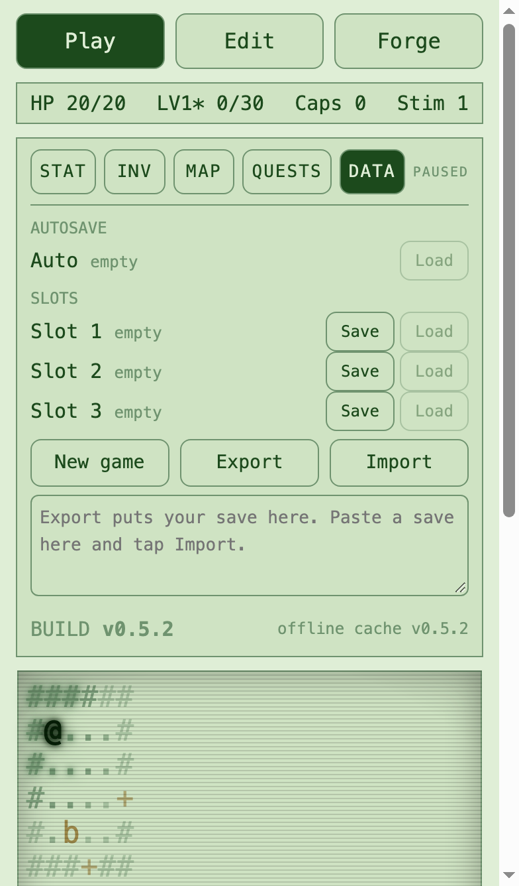

# Fallout ASCII — game

A small, complete post-apocalyptic roguelike that runs entirely in the browser as one
static page: no build step, no bundler, no dependencies, no server logic. You crawl a
vault, the outskirts and the ruins, fight radroaches and robots, manage radiation,
condition, ammo and caps, and talk your way through three small quest lines.

**This is the game app only.** G.E.C.K. — the map editor, Forge, job authoring
and save benchmark — is a separate app with its own deployment and repository. The
editor sections below describe that app; use them there, then bring the result over as
a content pack or as generated data files. See **Content packs** on this page and the
studio's README.

Everything is plain classic scripts hanging off a `WA` namespace, so `index.html` also
works when opened straight from disk, and the same files install as an offline PWA.



---

## Make your first map and enemy in 5 minutes

You can add content without touching a file. This walkthrough makes one enemy, a small
map that contains it, and plays it — about five minutes.

1. **Open the game** (see [Running the game](#running-the-game)) and stay on the **Play**
tab for a moment so everything boots.
2. **Open the Forge tab** → set the collection selector to **Enemies** → press **New**.
3. **Fill in the enemy.** Symbol `Z`, Name `Scrap Hound`, HP `10`, Damage min `2` max
`4`, Sight `6`, XP `10`, Caps min `0` max `4`, Behaviour `pursue`, Attack damage type
`melee`, Colour `bad`. Leave the effect and resistance fields alone.
4. **Press Save.** The message reads `Saved Scrap Hound.` — it now exists in the live
content and appears in the palette as a `Z` button.
5. **Open the Edit tab** → press **New map** (the W/H boxes set its size; `24 × 14` is a
fine default). Give it a name in the Name box and press Enter.
6. **Draw a room.** Pick a TILES brush — `Wall` around the edge, `Floor` inside — and
drag on the canvas. Use the `Wall border` button first if you want a quick outline.
7. **Place the start.** Choose the `@` brush under TOOLS and click an empty floor cell.
8. **Add content.** Under ENEMIES click `Z` and place a couple of Scrap Hounds; under
ITEMS place some `Caps` and maybe a `>` exit. (An exit does nothing until you use the
`link` tool to point it at another map.)
9. **Press Test.** The game switches to Play on your map with a throwaway character that
never autosaves. Walk into a hound to attack it, step on caps to pick them up, and press
`P` to check the Pip-Boy map. If you die, the death screen offers a save to load or
**Restart** at your home map.
10. **Keep or publish it.** Your map lives in this browser's map library and the enemy
lives in this browser's Forge overrides. Press **Export** on the Edit tab for a JSON
backup, or tick the map in the library and press **Ship to code** to download
`maps-authored.js` for `js/data/` so the map ships with the game itself.

If you ship files into the project, bump `WA_VERSION` in `js/data/version.js` (and update
`APP_FILES` in `service-worker.js` if you added or removed a file) so installed copies
pick the change up.

---

## Contents

- [Make your first map and enemy in 5 minutes](#make-your-first-map-and-enemy-in-5-minutes)
1. [Running the game](#running-the-game)
2. [The screen](#the-screen)
3. [Controls](#controls)
4. [Turns and actions](#turns-and-actions)
5. [Character and progression](#character-and-progression)
6. [The world map, vision and light](#the-world-map-vision-and-light)
7. [Symbol reference](#symbol-reference)
8. [Status effects](#status-effects)
9. [Combat](#combat)
10. [VATS](#vats)
11. [Items and the pack](#items-and-the-pack)
12. [The Pip-Boy](#the-pip-boy)
13. [NPCs, dialogue and quests](#npcs-dialogue-and-quests)
14. [Saving and storage](#saving-and-storage)
15. [The Edit tab (map editor)](#the-edit-tab-map-editor)
16. [The Forge tab (content editor)](#the-forge-tab-content-editor)
17. [The Bench tab (save benchmark)](#the-bench-tab-save-benchmark)
18. [Content data formats](#content-data-formats)
19. [Offline / PWA behaviour](#offline--pwa-behaviour)
20. [Project layout](#project-layout)
21. [Limits, balance numbers and troubleshooting](#limits-balance-numbers-and-troubleshooting)

---

## Running the game

**From the project folder, either:**

```bash
python3 -m http.server 3000        # then open http://localhost:3000
```

or simply open `index.html` in a browser. The file:// route plays fine; only the
service worker (offline cache) and the install prompt need an http(s) origin.

There is nothing to install, build or compile. Refresh to update; if a newer build is
cached the game offers a **Reload** banner (see [Offline / PWA](#offline--pwa-behaviour)).

**Installing:** with an http(s) origin and a browser that supports installable PWAs, use
the browser's "Install app" / "Add to home screen". It opens standalone with the green
`@` icon and works with no network afterwards.

## Deployment

This repository is the game alone, and a deployment is only its app files:

```bash
tools/stage-deploy.sh        # writes dist/
```

The stager copies `index.html`, `css/`, `js/`, `icons/`, `manifest.json` and
`service-worker.js` into `dist/`, leaves this README and `screenshots/` behind, and fails
if any path listed in the service worker's `APP_FILES` is missing from the staged tree.
`deploy.json` is the manifest for the live host: `worker.js` answers every request from
`dist/` through the static-assets binding and contains no server logic. Any static host
can serve `dist/` unchanged, because every path in the app is relative; it therefore also
works under a subpath. To redeploy, stage, upload `dist/` with `deploy.json`, and bump
`js/data/version.js` plus the service-worker changelog first so installed copies update.

Two checks run without a browser: `node tools/check-maps.js` validates every shipped
map's geometry, exits and overworld links, and `tools/check-studio-sync.sh [studio-dir]`
reports any shared runtime file that has drifted from the studio's copy.

**Live:** <https://wasteland-ascii-dswq78.freebuff.site>

---

## Opening and main menu

On launch the game plays a short skippable ASCII intro over the game shell, then opens
the main menu:

- **Load** opens the autosave and three manual save slots. Empty slots are disabled;
  loading a save restores it and closes the menu.
- **New game** closes the menu and starts a fresh character at the beginning of
  character creation. It does not auto-load an existing save.
- **Options** changes sound and ambience, animated effects, CRT scanlines/glow, fog of
  war, difficulty and world-turn pace immediately. Difficulty, pace and sound are also
  changeable in the Pip-Boy DATA screen.

There is no autosave read during boot anymore: the menu is always shown first, and the
player explicitly chooses Load or New game. The intro reveals each line in turn, then
waits on **Continue** so it can be read at your own pace. Press **Esc** or **Enter** to
skip the intro or back out of the Load/Options screens.

### Difficulty

Three presets apply immediately and are remembered on the device:

| Preset | Enemy damage | Your damage | Enemy accuracy | Finds and shop stock |
| --- | --- | --- | --- | --- |
| Easy | ×0.75 | ×1.25 | −10% | ×1.25 |
| Normal | ×1.0 | ×1.0 | standard | ×1.0 |
| Hard | ×1.25 | ×0.90 | +10% | ×0.75 |

Enemy damage covers attacks, traps, blasts and damage-over-time effects; your damage
covers weapon hits and blasts. Resource scaling applies to caps and ammo found, enemy
caps, and the starting stock and restocking of merchant stalls. The preset can be changed
from **Options** or from the Pip-Boy **DATA** screen, and switching back restores the
standard values without touching the save.

---

## The screen

The page has four top-level tabs — **Play**, **Edit**, **Forge**, **Bench** — and inside
Play a fixed-height character grid (25 columns × 13 rows of cells) that pans to keep you
roughly centred.

- **Status bar** (tap it, or the Pip-Boy button, to open the Pip-Boy). Fields, in order:
  - `DAY n HH:MM` — the in-game clock; one action advances two minutes.
  - `HP current/max` — turns red at 30% or less.
  - `LV#` — a `*` after the level means unspent SPECIAL points. Then `XP current/next`.
  - `Caps` — currency.
  - `Stim` — how many Stimpaks you carry.
  - The Fire button also shows the selected ammo count and `AP`/`JHP` tag.
  - `RADS n` — only shown when you have absorbed radiation.
  - `CRIPPLED L.ARM` — only while at least one limb is at 0 condition.
  - `CND n%` — only when the equipped weapon is below 25% condition.
  - `ARM n%` — only when the equipped armour is below 25% condition.
  - Status tags such as `BLEED 2 · RES 5` — each effect's short tag and remaining turns;
    `SHAKEN −10%` appears while a critical-failure penalty is active.
  - `◉ 12 NE` — the bearing and straight-line distance to the tracked quest waypoint
    while that objective is on the current map; when it is elsewhere the readout turns
    amber and names the map (`◉ Vault 42 Entrance`). Its tooltip names the job and the
    objective; the MAP tab carries the full text and a Clear button.
- **Map view** — the ASCII world, colour-coded by each definition's `c` (colour class)
  or a literal `#rrggbb`. Brightness follows the light level of the cell; explored but
  currently unlit cells are drawn at half opacity ("memories"), and unexplored cells are
  blank. Light comes from the map's ambient level plus lamps on tiles, items, enemies
  and the Pip-Boy lamp you always carry. Outdoor maps follow the in-game clock; indoor
  maps keep their authored ambient level. Rain and fog are visual overlays only.
- **Message log** — the last four lines of anything that happened. Newest at the bottom.
- **Action pad** — a 3×3 grid. Top row: VATS (shows `AP current/max`), Up, Pip-Boy.
  Middle row: Left, Wait, Right. Bottom row: Fire (shows the loaded ammo count),
  Down, Throw.
- **Overlays** — the Pip-Boy, VATS, trade and dialogue panels are not separate pages:
  they are panels that replace/cover part of the Play view and *pause the world* while
  open.
- **Update banner** — appears under the status bar when a newer build is waiting.

Colour classes used by content: `dim` (structure), `warn` (loot, doors, consumables),
`bad` (hostiles, hazards), `good` (friendly NPCs, better gear, radiation sources),
`hero` (the player's `@`). Forge can also store a hex colour, which bypasses the theme.

Display effects a definition can carry: `flicker`, `pulse`, `blink`, `rainbow` (animated
unless disabled), `glow`, a background colour, and `light` (a light radius).

---

## Content packs

The studio can hand the game a `wasteland-content.json` pack instead of requiring a
redeploy. A pack carries authored maps, tile/item/enemy definitions, jobs and dialogue
patches. Shipped content always loads first, so a pack adds to the game rather than
replacing its built-in jobs.

- **Menu → Content packs** — import a pack file, load one from a URL, or remove the
  active pack. The screen names the active pack, its fingerprint and its counts.
- **`?pack=<url>`** — imports and activates a pack on boot, then clears the parameter
  so a reload does not fetch it again. The URL must allow cross-origin reads (CORS).
- **Storage** — the active pack is kept in IndexedDB (`wasteland-content`), with a
  localStorage fallback. It survives reloads and keeps working offline; removing it
  returns the game to shipped content.
- **Validation** — a pack is fully checked before it is stored: format tag, version,
  map shape, definition ids, job structure and dialogue targets. A bad pack is rejected
  and the current content stays untouched.
- **Saves** — every save records the pack fingerprint it was made under. The Load
  screen marks saves made under a different pack, because their maps or definitions
  may have changed.

A release does not need a pack: the studio's **Export definitions for game** and
**Ship to code** buttons write `js/data/defs-authored.js`, `maps-authored.js` and
`quests-authored.js`, which the game loads as shipped content.

---

## Controls

Keyboard (Play tab, when focus is not in a text field):

| Key | Action |
| --- | --- |
| Arrow keys / `W A S D` | Move or attack one step; you turn that way, and the chevron on the edge of your cell points that way |
| Space | Wait — give up the rest of your AP so the world takes its turn |
| `H` | Use a Stimpak |
| `R` | Use RadAway |
| `F` | Fire the equipped ranged weapon |
| `G` | Throw an explosive at the nearest visible enemy |
| `←` / `→` or `A` / `D` | Move the lockpick while a lock is open |
| `Enter` / `Space` | Try the current notch |
| `Esc` | Give up on a lock (or close any panel) |
| `1`–`9` | Pick a word while hacking a terminal |
| `V` | Toggle VATS |
| `P` | Toggle the Pip-Boy |
| `Esc` | Close dialogue, otherwise close the Pip-Boy |

Touch/mouse: the arrows step once on tap and repeat while held; every other button is a
normal press. Tapping the status bar opens the Pip-Boy. In the editors, the palette
buttons select a brush and the canvas is painted by dragging.

---

## Turns and actions

The game is strictly turn-based; nothing is simulated on animation frames. The enemy
phase is paced for readability — one action per beat — but the beat is presentation
only: no rule reads a frame clock.

- Every action spends **AP**. A step costs 1, a melee attack 3, a ranged shot 4, a
  throw 3, and a Stimpak, RadAway, chem, Doctor check or other item use 2. Bonus Rate of
  Fire, Bonus HtH Attacks, Fast Shot and Bruiser move those numbers.
- A player turn lasts as long as the AP pool (`6 + Agility`). You keep acting while AP
  remains — two rifle shots, or one shot and three steps — and nothing refills the pool
  in between.
- When the last AP is spent, the pool refills and **every enemy takes one turn** in
  sequence order. Your status effects and the enemies' own tick once per action, so a
  bleed or a buff lasts the same two minutes it always did.
- **Enemies have AP too.** Each hostile carries its own pool — `round(Sequence / 2) + 2`,
  clamped to 3–8 — and spends it in its turn: 1 per step, 4 per attack, and never more
  than one attack before you act again. A quick raider crosses five or six tiles while a
  slow one shuffles three. A knockdown or an enemy's `rate` cooldown still costs it the
  whole turn. A gunner spends that pool keeping a firing line rather than closing in —
  see **Enemy movement** under Combat. Your own pool (`6 + Agility`) stays larger, so
  you can still outrun them.
- **Wait** gives up whatever AP is left: the world takes its turn at once and you start
  the next one with a full pool, even when AP is already empty.
- Each action advances the clock by two minutes whether or not the enemies act.
- **You can watch the world move.** When your AP runs out, the world's turn plays one
  action at a time, about a third of a second apart, redrawing the map and log between
  them: a raider crossing four tiles walks them instead of jumping, and companions move
  in the same beat once the enemies are done. Your own move gets that beat to itself
  first, and every body that changes cell slides in from where it was, so even a move
  that resolves in one frame — a sequence reaction, a step during a rest — reads as
  walking rather than a teleport.
- **You set the pace.** Options → World turn switches between Slow, Normal and Fast,
  and it is remembered on this device (the same switch is on the Pip-Boy's DATA
  screen, so you can change it mid-game). When a turn is taking too long, press
  `.` and the rest of it resolves at once — the remaining enemy and companion
  actions play out together and the board is painted once.
- **Hits land visibly.** A ranged shot flashes at the muzzle, a struck cell flares
  red, the damage floats up off it as a number — amber over anything you hit, red
  over you — and a kill bursts where the body fell. All of it is decoration over
  the board: the log still holds the record, and turning Animate off (or a system
  asking for reduced motion) drops the marks and leaves only the log. Input is held until the phase ends,
  exactly as an open panel holds it, so nothing can be spent mid-turn and the Pip-Boy,
  Fire, VATS and the pad all wait. A death taken during the phase ends the run as
  usual, and loading a save, starting a new game or travelling drops a phase in flight,
  so nothing from the old world keeps acting on the new one. Turning **Animate** off in
  Options (or setting your system to reduce motion) collapses the phase to instant, as
  before.
- **It sounds like the wastes.** A shot, a hit, a kill, a pickup and a level-up each
  have their own short sound, and all of them are synthesised in the browser with Web
  Audio: there are no audio files, so the offline cache gains nothing to download. A
  hit on you is lower and harder than a hit on anything else. Each place also has its
  own looping ambience, synthesised the same way: an electrical hum and moving air in
  the vault, rain over low wind outside, wind through the ruins, and a wet bed with
  the odd drip in the pumphouse. The beds cross-fade when you travel, duck for a
  moment under a shot or a kill so the hit stays clear, hush while the tab is hidden,
  and stay quiet under the boot menu. **Sound** in Options (or DATA on the Pip-Boy)
  turns the lot off with a short fade, which is remembered on this device, and a
  browser without Web Audio simply stays silent.
- Opening the Pip-Boy, a dialogue or a trade screen **pauses**: no world turn passes while
  the panel is up, so closing it does not hand the enemies a free move. Using a Stimpak,
  RadAway, chem, Doctor's Bag or any other item from the Pip-Boy still spends its 2 AP
  (as does the Doctor check), so the panel is not a free heal: if that empties your pool,
  the enemies take their turn with the panel still open.
- The SKILL screen's **REST** panel spends whole hours instead of turns: **Wait 1h**
  passes an hour, **Rest 4h/8h** also recovers 8% of maximum HP an hour. Each hour
  gives every enemy one action and ticks your status effects once, so a hostile that
  closes within three tiles breaks camp early; a hostile already that close refuses the
  attempt. Both refill AP and report the new day and time.
- People keep to the clock. Mira's stall opens **08:00–18:00**, Keeper Ada's market
  **07:00–21:00** and Technician Vale's post **06:00–22:00**. Outside their hours they
  step away to a night spot, and a closed stall hides its trade options until it
  opens again. Taking and handing in quests still works at any hour.
- Walking into an enemy attacks it. Walking into a person opens dialogue. Walking into a
  solid tile is refused (or tells you why). Walking into an exit tile with a link
  travels to that map.
- You die at 0 HP: the state is marked dead and the death screen opens above the map.
  Load the autosave or a manual slot to continue, or **Restart** from your home map.

---

## Character and progression

Starting character before creation: **20 HP**, fists 2–4 damage, 1 Stimpak, 1 RadAway,
1 repair kit, 1 Doctor's Bag, 0 caps, 18 × standard 10mm, 6 × 10mm AP, 6 × 10mm JHP,
10 × energy cells, all SPECIAL at 5 with **5 creation
points**, **15 skill points** (before Intelligence and traits are finalised), no tag
skills, no perks and no traits, `6 + A` AP, and about **9.9 / 150 lbs** carried at
Strength 5. A new game opens the four-step character creation described below before the
first turn; final HP, AP, carrying capacity and skill points depend on your choices.

### Fallout 1 traits and character creation

Every new non-test game opens **CHARACTER CREATION**, following Fallout 1's sequence:

1. **Identity** — name, age from 16 to 35, and gender. Age is cosmetic; gender is stored
   for dialogue and shown in the Pip-Boy. The three Fallout 1 premade characters are
   available as starting points: **Albert Cole** (charismatic), **Max Stone** (combat)
   and **Natalia Dubrovhsky** (stealth), or press **Custom** to start from scratch.
2. **SPECIAL** — 40 points across the seven attributes. Each starts at 5, can range from
   1 to 10, and all five creation points must be spent before continuing.
3. **Traits** — choose up to **two** of the 16 Fallout 1 traits, or none. Traits are
   permanent. Stat changes are applied once on confirmation; combat, skill and healing
   effects are read live.
4. **Tag skills** — choose exactly **three** of the 18 skills. A tag immediately gives
   **+20%** and doubles future point growth. The final skill-value preview includes your
   allocated SPECIAL, traits and tag bonus.

The selected identity, allocated SPECIAL, traits and tags are saved with the character.
Test mode skips creation, and saves made before traits existed load without it (their
`traitsDone` field defaults to true).

| Trait | Benefit | Cost | Working effect |
| --- | --- | --- | --- |
| Bloody Mess | +5% damage; every death is violent | Changes the ending | Damage multiplier on all your attacks; grisly kill text; the Sentinel epilogue uses its gore variant. |
| Bruiser | +2 Strength | −2 Action Points | Applied to SPECIAL and max AP (minimum 1 AP). |
| Chem Reliant | Chems last 50% longer | Addiction chance ×2 | Chem durations ×1.5 and addiction rolls are doubled. |
| Chem Resistant | Addiction chance halved | Chems last half as long | Chem durations ×0.5 and addiction rolls are halved. |
| Fast Metabolism | +2 HP from healing | +25% poison and radiation damage | Stimpaks, healing items and healing tiles restore 2 more; poison/rad damage ×1.25. |
| Fast Shot | −1 AP on weapon attacks | No aimed shots | Every attack costs 1 less AP (Fire, melee and VATS); VATS offers only the torso. |
| Finesse | +10% critical chance | −30% non-critical damage | Added to the crit roll; non-critical hits ×0.7. Criticals are unaffected. |
| Gifted | +1 to all SPECIAL | −10 to all skills, −5 skill points per level | Applied once (caps at 10); skill values −10; starting and per-level points reduced by 5. |
| Good Natured | +15 First Aid, Doctor, Speech, Barter | −10 to combat skills | Skill modifiers, applied live. |
| Heavy Handed | +4 melee and unarmed damage | −30% critical damage | Flat +4 on melee/unarmed; crit multiplier ×0.7. |
| Jinxed | Enemies fumble more | You fumble too | 5% critical failure for your attacks and enemy attacks: the attack is lost. |
| Kamikaze | Sequence +5 | Agility Armor Class 0 | Adds 5 Sequence; your Agility contribution to AC becomes 0, but worn armour still adds AC. |
| Night Person | +1 IN and PE at night | −1 IN and PE by day | Uses the in-game clock, **18:00–05:59** night. Alters effective IN/PE for skills, XP, sight radius and perk requirements; base SPECIAL is unchanged. |
| One Hander | +20% hit with one-handed weapons | −40% hit with two-handed weapons | Uses each weapon's `hands` field (Forge-editable). Applies to melee, Fire and VATS. |
| Skilled | +10 to all skills | A perk every four levels | Skill values +10; perks at levels 4, 8, 12… instead of 3, 6, 9… |
| Small Frame | +1 Agility | −25 lbs carry weight | Agility applied once; carry capacity is 25 lbs lower. |

All five formerly missing trait systems now exist. The approximations are explicit:
Armor Class comes from effective Agility plus armour, Sequence gives a first-strike
reaction, chem addiction uses withdrawal states rather than a scripted doctor visit,
and the Bloody Mess ending is the Sentinel epilogue rather than a full slide show.

### Carry weight

Capacity is `25 + 25 × effective Strength`, less **25 lbs** with Small Frame. The pack,
equipped weapon and armour, ammo rounds, Stimpaks, RadAway and repair kits all weigh
something. Every item has a Forge-editable `wt` (lbs); unedited items fall back to
class defaults. You cannot pick up a floor item, take loot or buy a bundle that would
exceed the limit. Already-carried weight can exceed capacity after a Strength withdrawal
— dropping an item puts it on your current tile, while **Drop** on ammo/supplies discards
it. Encumbrance does not slow movement, matching Fallout 1's pick-up restriction.

### Armor Class and sequence

**Armor Class** is effective Agility plus the equipped armour's `ac`, scaled by armour
condition. Leather Armor gives 5 AC, Combat Armor 10. Kamikaze sets the Agility part to
0 but keeps armour AC. An enemy's hit chance is
`clamp(75 + accuracy + 5 if ranged − AC − 30 if fumbling, 5, 95)`; a miss is a real
attack, not the old flat dodge percentage.

**Sequence** is `2 × effective Perception`, plus 5 with Kamikaze. A high-sequence enemy
that is already in attack range and line of sight gets one reaction before your action;
it then skips its normal action that round. The enemy phase itself is sorted by Sequence,
so faster enemies move and shoot before slower ones. Sequence also sets how many AP an
enemy has — `round(Sequence / 2) + 2`, clamped to 3–8 — so the same fast enemy covers
more ground. Heavy weapons and armour do not
change Sequence in this build.

### Addiction and withdrawal

Chems carry an `addict` chance (Buffout 40%, Jet 40%, Med-X 20%). When the chem buff
expires, the chance is rolled, modified by Chem Reliant/Resistant. A failed roll leaves a
withdrawal until cured:

| Chem | Withdrawal |
| --- | --- |
| Buffout | −2 Strength, −1 Endurance |
| Jet | −2 maximum AP |
| Med-X | −1 Agility, −1 Endurance |

Withdrawals are live effective-stat penalties, so skills, HP, AP, Armor Class, Sequence
and carry weight all update immediately. **Doctor: cure addiction** on the INV screen
costs a turn and succeeds at `clamp(30 + Doctor, 5, 90)%`; each success removes one
addiction.

### The Sentinel ending

Handing in **Silence the Sentinel** ends the road story and stores an epilogue. The
normal version describes the quiet road east; **Bloody Mess** replaces it with the
grislier version. Read or re-read it from **DATA → ENDING**.

| Stat | Effect |
| --- | --- |
| **S** Strength | `+⌊(S-1)/3⌋` melee damage; carry capacity `25 + 25×S`; raises Unarmed and Melee Weapons |
| **P** Perception | Sight radius `8 + (P-5)`; Sequence `2×P`; raises First Aid, Doctor, Lockpick and Traps |
| **E** Endurance | Max HP `+4 per point above 5`; raises Outdoorsman |
| **C** Charisma | Raises Speech and Barter; Barter lowers shop prices |
| **I** Intelligence | `+10% XP per point above 5`; `5 + 2×I` skill points per level (−5 with Gifted); raises Science, Repair and Doctor |
| **A** Agility | AP `+1/point`; Armor Class `+1/point`; raises the combat skills, Sneak, Steal and Lockpick |
| **L** Luck | Critical chance `2%/point` (criticals double damage); raises Gambling; Luck 8+ widens locks |

**Maximum HP** = `20 + (effective E-5)*4 + (level-1)*3 + veteran HP + Lifegiver - rads`,
minimum 5. Radiation and withdrawal therefore shrink the bar until flushed or cured.

**XP and levels:** the level cap is **100**. XP to the next level is
`round(20 + 14×level + 6×level^1.75)` — 40 at level 1, 497 at 10, 6,361 at 50 and
20,394 at 99, for **751,770 XP** in total to reach the cap. A kill gives
`round(scaled entity XP × (1 + (I-5)*0.1))`.

On level-up you grow max HP by 3 and heal 5 (plus the new max-HP gain). While any
SPECIAL is below 10 you also gain a point to spend on the STAT screen. Once all seven
are at 10 the point has nowhere to go, so every further level adds **+3 max HP** instead
(veteran HP, up to +96 by level 100). Every third level adds **+1 damage** to every
attack and every fifth level adds **+1 max AP**: at level 100 that is +33 damage and +19
AP (35 AP with Agility 10). Every third level also banks a **perk choice** (every fourth
with Skilled); levels also award `5 + 2×INT` skill points, less 5 with Gifted. Night
Person's temporary Intelligence changes both the skill-point award and the XP bonus.

### Fallout 1 skills and tag skills

The character sheet has all **18 Fallout 1 skills**. Values are percentages from 0 to
200 and follow SPECIAL in real time: change a stat and every dependent skill changes
with it. Halves round down.

| Skill | Initial value | Skill | Initial value |
| --- | --- | --- | --- |
| Small Guns | `35 + AG` | Science | `25 + 2×IN` |
| Big Guns | `10 + AG` | Repair | `20 + IN` |
| Energy Weapons | `10 + AG` | Speech | `25 + 2×CH` |
| Unarmed | `65 + (AG+ST)/2` | Barter | `20 + 2×CH` |
| Melee Weapons | `55 + (AG+ST)/2` | Gambling | `20 + 3×LK` |
| Throwing | `40 + AG` | Outdoorsman | `5 + (IN+EN)/2` |
| First Aid | `30 + (PE+IN)/2` | Lockpick | `20 + (PE+AG)/2` |
| Doctor | `15 + (PE+IN)/2` | Sneak | `25 + AG` |
| Steal | `20 + AG` | Traps | `20 + (PE+AG)/2` |

- Skill values use the **effective** SPECIAL: Night Person's +1 IN/PE at night changes
  every dependent skill, and trait modifiers (Gifted −10, Skilled +10, Good Natured) are
  added on top. Base SPECIAL is never rewritten by Night Person.
- You start with `5 + 2×INT` skill points (15 at Intelligence 5, 12 with Gifted) and gain
  the same amount on every level-up, less 5 with Gifted. Unspent points are banked up to
  **99**; any excess is lost, as in Fallout 1.
- **1 point raises a skill by 1%**, or **2% if it is tagged**, all the way to **200%**.
  There is no escalating cost; that is a Fallout 2 change.
- New characters choose **three tag skills during creation**; tagging gives **+20%**
  immediately and doubles all future growth in it. The SKILL screen can fill any
  remaining slots on older saves, and the **Tag!** perk adds a fourth slot at level 12.
- Skill values are only stored as invested points. The base formula is recalculated from
  SPECIAL, so a stat change is reflected immediately without a respec.

### Skill books and permanent rewards

Six one-use books raise a skill by **+5%** when read: *Guns and Bullets* (Small Guns),
*Big Book of Science* (Science), *Dean's Electronics* (Repair), *Tumblers Today*
(Lockpick), *Wasteland Survival Guide* (Outdoorsman) and *First Aid Manual* (First Aid).
They sit in existing stock and containers: Mira sells *Guns and Bullets*, Keeper Ada sells
*Big Book of Science*, Sable sells *Tumblers Today*, the market lockbox holds *Dean's
Electronics*, a footlocker holds the *Wasteland Survival Guide*, and a medical box holds
the *First Aid Manual*.

The **Endurance Module** in the Vault Safe is the permanent SPECIAL reward: using it
raises Endurance by 1 and adds the resulting 4 maximum HP, then consumes the module. A
book at a maxed 200% skill, or the module at Endurance 10, refuses without being used up.
Skill gains go straight into the saved `S.skillPts`, and the module into `S.sp`, so both
survive saves and map travel.

The **REST** panel below the FIELD KIT spends whole hours: **Wait 1h** passes time,
**Rest 4h** and **Rest 8h** also recover HP. Each hour ticks status effects and gives
enemies one action, and a hostile within three tiles interrupts the rest; both actions
refill AP and print the new time.

**Where skills are used today:** the six combat skills drive hit chances; Lockpick
widens the lock dial; Science adds terminal attempts; Barter improves buy and sell
prices; Speech drives dialogue checks. The SKILL screen's **FIELD KIT** spends AP on First Aid
(healing), Doctor (healing, poison, radiation and, with a Doctor's Bag, crippled limbs), Repair (condition without
a kit or nearby world objects), Traps (scanning and disarming nearby hazards) and Sneak
(a persistent stealth stance with detection rolls, light- and movement-sensitive detection,
and a sneak-attack bonus). Outdoorsman shapes overworld travel; Steal drives shelf,
pocket and owned-container theft. Gambling sets the odds at Croup's dice table in the
ruins: a 5–50 cap wager on a seven pays 4:1, or 5:1 when a Gambling 30 check lands,
and a 5–10 cap boxcars wager on double sixes pays 26:1, or 30:1 on a Gambling 35 check.
The STAT screen labels each SPECIAL with the systems it feeds.

### Croup's dice table

Croup waits at the ruins market with two dice and two wagers, chosen with the tabs at
the top of his panel.

**Lucky Seven** is the steady bet. Wager **5, 10, 25 or 50 caps**; a seven pays
**4:1**. Every roll also makes a **Gambling 30 check**, and a made check lifts the
payout to **5:1**. A seven is 1 in 6, so a failed check returns 83.3% of the stake and
a made check returns 100%. Because check chances cap at 95%, the best possible long-run
return is **99.2%** — still a house edge, but a thin one once Gambling is maxed out.

**Boxcars** is the long shot, with its own odds and a smaller **10-cap table limit**
(stakes of **5 or 10 caps**). Double sixes is 1 in 36 and pays **26:1**, or **30:1** on
a made **Gambling 35** check. That returns 75.0% at base odds and 85.6% at the check
cap, so the bigger swing never becomes the better bet.

The wager, the dice, the check and the net caps are printed in the shared table log,
and the session line tracks the running result across both bets. Winnings and losses
move the real cap balance and autosave.

### Fallout 1 perks

Every **third level** banks one perk choice (every **fourth** with Skilled). The Pip-Boy
**PERKS** screen lists only the perks you qualify for, using effective SPECIAL so Night
Person can meet a prerequisite at night and lose it by day. These thirty have working
effects:

| Perk | Level | Prerequisites | Max | Effect |
| --- | --- | --- | --- | --- |
| Swift Learner | 3 | IN 4 | 3 | +5% XP per rank |
| Toughness | 3 | EN 6, LK 6 | 3 | +10% damage resistance per rank |
| Bonus HtH Damage | 6 | ST 6, AG 6 | 3 | +2 unarmed/melee damage per rank |
| Bonus Ranged Damage | 6 | AG 6, LK 6 | 2 | +2 ranged damage per rank |
| More Criticals | 6 | LK 6 | 3 | +5% critical chance per rank |
| Educated | 6 | IN 6 | 3 | +2 skill points per level per rank |
| Strong Back | 6 | ST 5, EN 5 | 1 | +25 lbs carry weight |
| Fortune Finder | 6 | LK 6 | 1 | +25% caps found |
| Rad Resistance | 6 | EN 6 | 2 | Radiation leaves 15% fewer rads per rank |
| Snakeater | 6 | EN 3 | 2 | +25% poison resistance per rank |
| Fast Metabolism | 6 | EN 5 | 2 | Stimpaks and First Aid heal +50% per rank |
| Chem Resistant | 6 | EN 6 | 1 | Half the normal addiction chance |
| Heave Ho! | 6 | ST 6 | 2 | +2 throwing range per rank |
| Better Criticals | 9 | PE 6, LK 6 | 1 | Criticals deal ×2.5 instead of ×2 |
| Bonus Rate of Fire | 9 | PE 6, IN 6, AG 7 | 1 | Ranged attacks cost 1 less AP (Fire and VATS) |
| Scrounger | 9 | LK 6 | 1 | Ammo found is 25% more plentiful |
| Stonewall | 9 | EN 6 | 1 | Knockdowns and knockbacks cannot move you |
| Dodger | 9 | AG 6 | 1 | +5 Armour Class |
| Adrenaline Rush | 9 | ST 6 | 1 | +3 damage below half health |
| Sharpshooter | 9 | PE 6, IN 6 | 1 | +10% ranged hit chance |
| Pyromaniac | 9 | — | 1 | +5 damage with fire weapons |
| Demolition Expert | 9 | IN 6 | 2 | +25% explosive damage per rank |
| Master Thief | 9 | AG 6 | 1 | Wider lockpicking sweet spot |
| Computer Whiz | 9 | IN 6 | 1 | +1 attempt on every terminal |
| Action Boy | 12 | AG 5 | 2 | +1 max AP per rank |
| Lifegiver | 12 | EN 4 | 3 | +4 max HP per rank |
| Tag! | 12 | — | 1 | One extra tag slot |
| Bonus HtH Attacks | 12 | AG 6 | 1 | Melee/unarmed attacks cost 1 less AP (bump and VATS) |
| Sniper | 12 | PE 8, AG 8 | 1 | +10% ranged hit chance at 5+ tiles |
| Silent Death | 18 | AG 10 | 1 | Sneak attacks deal ×4 instead of ×2 |

This is the full M8 target of thirty working perks. Perks that depend on systems the
game does not have are still left out rather than shown as dead choices.

**RADS:** radiation damage adds rads (rad puddles, irradiated enemies, the Irradiated
status, irradiated meat), and Rad Resistance reduces how many are absorbed. Each rad is
one point of max HP lost. RadAway flushes 30 at a time; the meter caps at 999.

### Scaling for a long campaign

The game is sized for a campaign of roughly **1000 maps of up to 200×200**, with sub-maps
(vault levels, ruins, rooms) as their own map records and dozens of quests. Nothing
hard-caps the map count; progression and saves are built for that span.

| Level | XP to next | Total XP | Base max HP | Damage bonus | AP bonus |
| --- | --- | --- | --- | --- | --- |
| 1 | 40 | 0 | 20 | +0 | +0 |
| 10 | 497 | 1,873 | 47 | +3 | +1 |
| 25 | 2,047 | 19,096 | 92 | +8 | +4 |
| 50 | 6,361 | 117,886 | 167 | +16 | +9 |
| 75 | 12,539 | 347,395 | 242 | +24 | +14 |
| 100 | 20,394 | 751,770 | 317 | +33 | +19 |

Base max HP is Endurance 5 with no veteran HP: max SPECIAL adds 20 more, and the
all-SPECIAL-maxed veteran levels add up to 96, for **433 HP at level 100**.

**Levelled enemies.** An entity's `lvl` (1–100, a Forge field) scales its authored
stats: HP ×(1 + 0.07×(lvl−1)), damage ×(1 + 0.05×(lvl−1)), XP ×(1 + 0.08×(lvl−1)) and
caps ×(1 + 0.04×(lvl−1)). A `lvl: 50` raider has 62 HP, hits 7–17 and gives 98 XP; at
`lvl: 100` it has 111 HP, hits 12–30 and gives 178 XP. One template can fill a whole
region, and the Forge field is optional — enemies without a level stay at level 1.

**Quests and exploration.** Quest XP is `base × (1 + 0.25×(lvl−1))` when handed in, so
an early 25-XP job is worth 331 at level 50 and 644 at 100. Reaching a map for the first
time gives **+12 XP** (12,000 XP across 1000 maps, under 2% of the cap).

**Saving at scale.** State and visited maps are separate records: the player state plus
one record per map you have left. A 200×200 map record is about 10 KB (its fog is 5,000
bytes packed as 10,000 hex characters, plus items/entities), so 1000 visited maps is
roughly 10 MB spread across 1000 records; the first split save writes them once, and
autosave afterwards writes only the map just left. Those left maps also stay packed in
memory, so a load does not expand every fog grid.

A full browser benchmark with **1000 synthetic 200×200 maps** (all fog packed, one
200×200 map live) produced **999 map records** of **~9.9 KB average, 10.0 MB total**,
plus a 364 KB state record. On the cloud VM the first split save took **102 ms**; a
state-only save **4 ms**; the debounced autosave **426 ms** including its 400 ms timer;
leaving a map and saving **6 ms**; a cold load of all 999 map records **62 ms**, with the
page heap around 42 MB and fog still packed. IndexedDB handles the full set; the
localStorage fallback still has a ~5 MB budget, and exporting 1000 maps is a
multi-megabyte JSON file.

## The world map, vision and light

- Maps are tile grids plus a list of things placed on them. Tile *IDs* are stored; the
  glyph shown always comes from the current definition, so renaming or restyling a tile
  updates every map that uses it.
- **Field of view** is recursive shadowcasting in eight octants, recomputed when you act.
  Walls block sight; everything you have seen stays memorised (dimmer) and is tracked
  per map as packed bits in saves.
- **Lighting** is computed once per action: the map's `amb` (0 = pitch black, 1 = fully
  lit) plus every `light` source, blocked by walls, plus your lamp (radius 3.6). Outdoor
  `amb` follows the game clock through dawn, day, dusk and night; `indoor` maps keep
  their authored level. Cell brightness maps to opacity in four steps; very bright cells
  get the `lit` look.
- **Weather** is authored per map with `weather: "rain"` or `"fog"`; it is a subtle
  pointer-events-free canvas overlay with moving rain streaks and drifting fog banks.
  It never changes visibility, movement or combat. Indoor maps suppress weather. The
  animation pauses with modal panels and hidden tabs and follows the **Animated effects**
  and reduced-motion settings; when animations are off it draws a static frame.
- **Travel:** exit tiles are linked per map (`exits: {"x,y": "mapid"}`). Arriving puts
  you beside the exit that leads back where you came from. Crossing maps preserves your
  whole character and each map's local state (dead enemies, taken loot, explored fog).
- **The road east:** the ruins' east exit opens onto **Route 9**, a rain-swept bypass
  whose middle span is broken, and its far end leads into the **Flooded Pumphouse** that
  the market draws its water from. The broken span is solid until repaired: people can
  walk around it, carts cannot. Road packs and a raider gunner hold the crossing, with an
  ammo cache and a repair kit beside the span; the dark pump room is guarded by a
  mirelurk and a ghoul, and its maintenance corners hold a kit, RadAway and bobby pins.
- **Overworld travel** (Pip-Boy MAP) lists every place you have visited, the roads
  between them, the hours each trip takes and the terrain that road runs through. Time
  passes on the game clock, and a road encounter can follow you in on arrival;
  Outdoorsman shortens the trip, lowers the chance of trouble and can slip you past an
  ambush. Each terrain — the vault approach, the open road, the bypass, the ruins, the
  flooded ground — has its own weighted table of trouble and its own danger multiplier,
  so the ruins and the pumphouse are worse ground than open road. Routes only cross places you have already
  visited, and travel is refused while enemies are within three tiles.
- Maps smaller than the viewport are shown at their real size; larger ones scroll with
  the camera.

---

## Symbol reference

These tables describe the core definitions. Every one can be edited, and new ones created,
in the Forge — the tables describe the data, not hard-coded behaviour. The map editor also
ships additional wall, floor, door, trap, recovery and terminal variants; more creature,
raider and robot archetypes; and a wider arsenal of weapons, ammo, armor, aid, keys,
containers and explosives. Use the palette search to find them by name, glyph or ID.

The first **safe-symbol pack** adds guide-inspired Vault and ruin surfaces, roads,
water/terrain variants, furniture-like structures, creatures, weapons, armor, tools and
security props. It deliberately reuses glyphs: the ID carries the behavior, while color,
background, glow and effect carry the visual distinction. Duplicate-glyph palette buttons
show their names, and packed maps assign internal legend characters automatically. Hand-
written legacy text maps still use one character per tile, so there a repeated glyph can
only mean one tile ID.

### Tiles

| Glyph | ID | Name | Behaviour |
| --- | --- | --- | --- |
| `#` | `wall` | Wall | Solid, blocks sight and movement |
| `.` | `floor` | Floor | Walkable |
| `+` | `door` | Door | Solid; walking into it converts it to `door_open` and costs the turn |
| `/` | `door_open` | Open door | Walkable |
| `T` | `terminal` | Terminal | Solid, lit (5); opens the password screen (hack 2, releases `vault_key` locks) |
| `D` | `secure_door` | Security door | Solid; needs `vault_key` (or a hacked terminal), then becomes `door_open` |
| `~` | `rad_puddle` | Rad puddle | 1 radiation damage + Irradiated 2 turns, lit (2) |
| `>` | `exit` | Exit | Travels when linked, otherwise explains it is unlinked |
| `w` | `clean_water` | Clean water | Heals 2 HP each step |
| `x` | `toxic_waste` | Toxic waste | 1 poison damage, +2 rads, Poisoned |

Tile fields the engine understands: `solid`, `trap` (scanned and disarmed by the FIELD
KIT), `opens` (tile it becomes), `needs` (item ID required to pass), `hack` (1–3, turns
the tile into a hackable terminal) and `unlockKey` (key item whose locks a successful
hack releases), `hurt` + `dt` (damage and its type), `onHit` + `dur` + `mag` (status
effect applied on step), `rads`, `heal`, `msg`, `exit`, `light`, plus the look fields.

### Enemies and people

| Glyph | ID | Name | HP | Damage | Notes |
| --- | --- | --- | --- | --- | --- |
| `r` | `radroach` | Radroach | 6 | 1–2 melee | Wanders; 50% radiation resist; drops 0–3 caps |
| `P` | `protectron` | Protectron | 16 | 2–5 energy, range 5 | Ranged; 50% ballistic resist, −50% energy, 90% radiation |
| `S` | `rust_sentinel` | Rust Sentinel | 28 | 3–6 energy, range 5 | Boss, pulses light; 40% ballistic, −25% energy, 90% radiation |
| `U` | `yao_guai` | Yao guai | 28 | 4–8 melee | Pursues; knocks the player back (30% per hit); 15% ballistic resist |
| `ς` | `radscorpion_matriarch` | Radscorpion matriarch | 30 | 8–10 poison + Poisoned | Pursues; no `knockback`, so 8+ hits roll the 15% heavy-hit push; 25% ballistic, 60% radiation |
| `g` | `feral_ghoul` | Feral Ghoul | 12 | 2–4 melee + Irradiated | Pursues; 90% radiation resist, 25% ballistic |
| `R` | `raider` | Raider | 14 | 2–5 melee | Pursues; drops 10mm Rounds |
| `N` | `mira` | Mira | 10 | 1–2 | Scavenger; trades 08:00–18:00; gives *Silence the Sentinel* |
| `V` | `vale` | Technician Vale | 10 | 1–2 | Vault technician, post 06:00–22:00; gives *Spare Cells* |
| `K` | `keeper` | Keeper Ada | 10 | 1–2 | Ruins keeper; trades 07:00–21:00; gives *Power in the Ruins* |
| `ʘ` | `ash` | Ash | 12 | 2–4 | Caravan guard on the outskirts road; gives *Blood on the Road* and joins once it is done |
| `ƒ` | `fence` | Sable | 10 | 1–2 | Night fence, 20:00–04:00; buys stolen goods, clears bounties; gives *Ears to the Ground* |
| `♦` | `dealer` | Croup | 12 | 2–4 | Dice dealer in the ruins; gives *Lighting the Table* |
| `Ω` | `rook` | Rook | 12 | 2–4 | Ruins scavenger; gives *Something in the Walls* and can join the party |
| `λ` | `vera` | Vera | 12 | 2–4 | Road warden on the outskirts; gives *Wolves at the Door* and can be hired for 15 caps |
| `Ʀ` | `raider_rivet` | Rivet | 26 | 4–8 ballistic, range 5 | Named raider boss in the ruins south-east; 25% ballistic resist, drops a double-barrel shotgun |

Enemy fields: `lvl` (1–100, scales the stats below), `hp`, `dmg` min/max, `sight`, `xp`, `caps` min/max, `ai`, `range`,
`rate` (turns between shots, default 1 melee / 2 ranged), `dt`, `onHit`, `res`,
`drop`, `light`, plus the look fields, `talk` (a dialogue tree), `schedule` (working
hours and night spot) and `merchant` (stock, stall caps and watchfulness), see below.

**Behaviour (`ai`):** `wander` drifts randomly until it sees you, then hunts; `pursue`
walks the shortest path to you (A*); `ranged` shoots while it can see you within range,
otherwise closes; `turret` never moves and only shoots; `idle` with `talk: true` never
takes a turn.

### Items

| Glyph | ID | Name | Class | Effect |
| --- | --- | --- | --- | --- |
| `$` | `caps` | Caps | caps | Adds 3–12 caps |
| `!` | `stimpak` | Stimpak | stim | Counted as a stim; heals 10, costs a turn |
| `✚` | `doctor_bag` | Doctor's Bag | junk | Sets every crippled limb; used by Doctor or from INV |
| `%` | `radaway` | RadAway | radaway | Flushes 30 rads, costs a turn |
| `&` | `repair_kit` | Repair Kit | repair | Restores 40 condition when repairing |
| `=` | `ammo_10mm` | 10mm Rounds | ammo | Adds 8–16 standard rounds to the pouch |
| `=` | `ammo_10mm_ap` | 10mm AP Rounds | ammo | ×0.8 damage, ignores 30 points of resistance |
| `=` | `ammo_10mm_jhp` | 10mm JHP Rounds | ammo | ×1.3 damage, target resistance +15 points |
| `^` | `ammo_ecell` | Energy Cells | ammo | Adds 6–12 rounds to the pouch |
| `b` | `baseball_bat` | Baseball Bat | weapon | 3–6 melee, range 1 |
| `p` | `pistol_10mm` | 10mm Pistol | weapon | 2–5 ballistic, range 6, uses 10mm |
| `l` | `laser_pistol` | Laser Pistol | weapon | 4–7 energy, range 7, uses energy cells |
| `a` | `leather_armor` | Leather Armor | armor | Blocks 2; ballistic +10%, fire −10% |
| `A` | `combat_armor` | Combat Armor | armor | Blocks 4; ballistic +30%, energy +15%, fire −25% |
| `o` | `nuka_cola` | Nuka-Cola | food | +6 HP, +2 AP |
| `f` | `cram` | Cram | food | +10 HP |
| `m` | `irradiated_meat` | Irradiated Meat | food | +4 HP, Irradiated 3 turns |
| `k` | `vault_key` | Vault Keycard | key | Carried; satisfies `needs` on locked tiles |
| `B` | `buffout` | Buffout | chem | Jacked 3 for 8 turns (+3 melee) |
| `j` | `jet` | Jet | chem | Stimulated 2 for 6 turns (+2 AP/turn) |
| `M` | `medx` | Med-X | chem | Fortified 4 for 8 turns (soaks 4 damage per hit) |
| `*` | `grenade` | Frag Grenade | explosive | 5–9 explosive damage, blast radius 2, throw range 6 |
| `i` | `molotov` | Molotov | explosive | 3–6 fire damage, blast radius 2, throw range 5, Burning 2×2 |
| `c` | `crate` | Crate | container | Holds 10mm rounds, caps, Cram and a bobby pin |
| `F` | `footlocker` | Footlocker | container | Average lock; Stimpak, Doctor's Bag, energy cells, 10mm AP, RadAway and a bobby pin |
| `G` | `strongbox` | Strongbox | container | Hard lock; caps, 10mm rounds and a bobby pin |
| `H` | `safe` | Vault Safe | container | Average lock, opens with the Vault Keycard; caps, Stimpak, grenade |
| `n` | `bobby_pin` | Bobby Pin | junk | Spent when a lock probe snaps |
| `X` | `corpse` | Corpse | container | Engine-made remains; enemies with `loot` leave one |

Item classes: `caps`, `ammo`, `weapon`, `explosive`, `armor`, `stim`, `radaway`, `repair`,
`food`, `chem`, `key`, `container`, `junk`. Stims, RadAway and repair kits live in counters on the character
(`s.stims`, `s.radaways`, `s.kits`); ammo lives in a pouch keyed by ammo item ID; gear,
food, chems, keys and junk live in the pack array. Caps are added straight to the wallet.
Ammo items can carry `caliber`, `variant`, `dmgMul`, `pen` and `resMod`; weapons can
carry `caliber`, `burst`, `spread` and `knockback`; enemies can carry `knockback`.
Items may also carry a `val` base price in caps; items without one are valued by class
and, for weapons and armour, by their combat stats. These fields are exposed in the
Forge.

---

## Status effects

Statuses tick once per world turn, last between 1 and 20 turns, and have a strength from
1 to 20. Harmful effects deal damage every turn; buffs help every turn.

| Tag | ID | Name | Kind | Per turn |
| --- | --- | --- | --- | --- |
| `BLEED` | `bleed` | Bleeding | harmful | ballistic damage, reduced by armour's blocked value (`max(1, mag - def/2)`) |
| `BURN` | `burn` | Burning | harmful | fire damage, reduced the same way |
| `IRRAD` | `rad` | Irradiated | harmful | radiation damage **and** rads; ignores armour |
| `POISON` | `poison` | Poisoned | harmful | poison damage; ignores armour |
| `RES` | `resist` | Fortified | buff | flat `mag` reduction on every direct non-radiation, non-poison hit |
| `AP+` | `apregen` | Stimulated | buff | `+mag` AP, capped at max AP |
| `STR` | `strength` | Jacked | buff | `+mag` melee damage |

Sources: weapon `onHit` (applied to the target), enemy `onHit` (applied when they hit
you), tile `onHit` (applied whenever you step on it, with or without damage), food/chem
`onHit` (applied when eaten/used), and a guaranteed Bleed on critical hits. A buff placed
on an enemy is harmless to it — it simply ticks down.

**Fortified** applies after armour, never reduces a hit below 1, and does not apply to
damage-over-time ticks. **Stimulated** fires at the start of each world turn.
**Jacked** applies to melee swings only, before multipliers and criticals.

Duration/strength fields are only shown and saved for content that actually has an
effect, so cleaning up a definition never leaves dead values behind.

---

## Combat

### Melee and basic attacks

Walk into an enemy to attack it with the equipped weapon (or fists). The attack rolls
against the weapon's **combat skill** (Unarmed for fists, Melee Weapons for a melee
weapon): `chance = clamp(skill + 30 - 5×(distance-1) + trait hit mod − 20 per crippled arm − SHAKEN, 5, 95)`. One
Hander adds +20 for a one-handed weapon and −40 for a two-handed one; fists are
unaffected. A miss still costs the turn and wears the weapon. Damage is
`random(wp.dmg) + ⌊(S-1)/3⌋` for melee, plus the strength buff, Bonus HtH/Ranged Damage
ranks and Heavy Handed's +4, doubled on a critical (×2.5 with Better Criticals, ×0.7
with Heavy Handed), then multiplied by condition and the trait damage multiplier
(Bloody Mess ×1.05, Finesse ×0.7 on non-criticals), and finally reduced by the target's
resistance for the damage type. Every swing wears the weapon.

### Ranged fire (`Fire`)

Requires a weapon whose `range` is 2 or more. Fire aims at the enemy you marked with
**Set** in VATS; with nothing marked it picks the nearest visible valid target within
range (`los` through walls is refused). A marked enemy that steps out of range is
refused rather than silently swapped, and the mark drops when it dies. The marked enemy
wears a red ring on the map and is named `TGT …` in the status bar. The shot spends
**4 AP** (3 for melee, less with the attack-cost perks), one round, applies weapon wear
and a possible jam, then hits with
`chance = clamp(combat skill + 30 - 5×(distance-1) + trait hit mod − 20 per crippled arm, 5, 95)`. Small Guns
covers ordinary pistols/rifles, Energy Weapons covers lasers and plasma, and Big Guns
covers heavy weapons. One Hander's +20/−40 applies through each weapon's `hands` field.
A miss still costs the turn and the round.

### Enemy movement

A `ranged` enemy fights for its firing line, next to the player or a companion.
Crowded at one tile with AP for both a step and a shot, it backs out to the roomiest
free tile that still holds a line on its target — at least two tiles away, no farther
than its own `range` — and shoots from there on the next pass of its pool. With AP for
only the step or only the shot, it swings instead, so a spent or cornered gunner still
trades blows. When a wall breaks the line it sidesteps to a neighbouring tile that can
see the target rather than walking straight on, and once it has fired it holds that
ground instead of advancing back to arm's length with its leftover AP. Turrets
(`ai: "turret"`) never move; pursuing, wandering and the walk to a last-seen tile are
unchanged.

### Burst fire and ammunition

The **SMG** is a burst weapon (`burst: 4`, `spread: 10`). It spends up to four rounds,
rolls each shot separately, and applies a further `−10%` to-hit for every shot after the
first. A burst stops early if the target dies; the weapon wears once and one jam check
is made for the whole burst. Four rounds against soft targets is strong; against armour
or at long range the spread and ammo cost are the trade-off.

The 10mm family has three selectable rounds:

| Variant | Damage | Armour interaction |
| --- | --- | --- |
| Standard | ×1.0 | none |
| AP | ×0.8 | ignores 30 percentage points of resistance |
| JHP | ×1.3 | target resistance is 15 percentage points higher |

Ammo choice is free and does not pass a turn. Use **Ammo** on the INV weapon row or in
the VATS header to cycle the selected 10mm variant; Fire, the Fire button count and VATS
all use the selection. The choice is remembered per caliber and saved with the run. The
SMG, 10mm pistol and pipe pistol share the 10mm family; other weapons keep their single
ammo type until a `caliber` family is authored in the Forge.

### Knockdown and critical failures

Heavy hits can move people. A player hit with a weapon's `knockback` field has a **35%**
knockdown chance; a 9+ hit without that field has a **20%** chance. A knockdown pushes the
target one free tile away and costs it its next action. Blasts always do this to every
surviving enemy in the radius. Enemy melee with a `knockback` field has a **30%** chance;
a raw hit of 8 or more without the field has a **15%** chance. A player knockdown pushes
one free tile and costs 2 AP. If the push is blocked, the target is still staggered.

Every player attack also has a **3% critical-failure** chance, checked after Jinxed. The
four outcomes are:

| Failure | Effect |
| --- | --- |
| Dropped weapon | The equipped weapon falls to a free nearby tile and is unequipped |
| Spilled ammo | 1–3 rounds of the loaded ammo are lost |
| Self-hit | The attack hits you for its normal weapon damage |
| Shaken | −10% to hit for 3 turns; shown as `SHAKEN` in the HUD and STAT |

Critical failures spend the action, ammo and condition as usual. They apply to melee,
Fire, VATS and thrown explosives.

### Armor Class and enemy accuracy

Enemy attacks now make a to-hit roll instead of always landing. The player's **AC** is
effective Agility plus conditioned armour AC (Leather 5, Combat 10); Kamikaze removes
the Agility part. The roll is
`clamp(75 + enemy accuracy + 5 if ranged − player AC − 30 if the enemy is fumbling, 5, 95)`.
A miss still spends the enemy's action. This replaces the old flat `3% × Agility` dodge.

### Throwables (`Throw` button, `G`)

Explosives are carried in the pack like any item. Pressing **Throw** (or `G`, or the
bomb button beside the arrows) takes the first explosive in pack order and throws it at
the **nearest visible enemy within that item's `range`** (no free aiming):

- The throw is checked against the **Throwing** skill
  (`skill + 30 - 5×(distance-1) − 20 per crippled arm − SHAKEN`). A miss lands one tile off target, where it can still
  catch the target in the blast.
- The target's tile takes the full roll of `dmg`; every other enemy within `blast` tiles
  takes **75%** at distance 1 and **50%** at distance 2 or more (minimum 1).
- Every enemy caught is hit with the item's damage type, can be killed normally (caps,
  XP, drops and quest credit), and suffers the item's `onHit` status.
- **You are caught in your own blast too** if you are inside the radius: armour,
  resistances and the Fortified buff apply, and your armour wears from it.
- The item is consumed and the throw spends 3 AP; having no target or nothing to throw
  costs nothing.
- Frag Grenades deal explosive damage; Molotovs deal fire damage and set anything caught
  Burning.

### Damage types and resistance

Seven types: `melee`, `ballistic`, `energy`, `explosive`, `fire`, `poison`,
`radiation`. Resistance is stored as a percentage on the target (`res: { ballistic: 40 }`)
and clamps to −100…95, so negatives are weaknesses. **Radiation and poison ignore
armour entirely**; everything else is reduced by the armour's resistance fraction first
and then its flat "damage blocked" value, never below 1.

The player's armour protection scales with condition
(`0.6 + 0.4 × condition/100`; 0 when ruined), and absorbing damage wears it down by
`max(1, round(absorbed/2))`.

### Limb condition

The player has four limbs, each with 0–100 condition: `L.ARM`, `R.ARM`, `L.LEG` and
`R.LEG`. Physical hits have a 50% chance to land on a healthy limb instead of the torso,
reducing that limb by `max(20, damage × 5)` (`damage × 7` for explosives). Radiation
and poison never damage limbs. A limb at 0 is **crippled**:

- Each crippled arm gives **−20% to hit** with every attack, including VATS and throwing.
- Each crippled leg removes **1 maximum AP**, to a minimum of 1.
- The status bar shows the crippled limbs, and the Pip-Boy STAT screen shows all four
  condition values.

A **Doctor's Bag** is carried in the pack and starts in the Vault Dweller's kit. The
FIELD KIT's Doctor action spends 2 AP and one bag to set every crippled limb, alongside
its normal HP, poison and radiation treatment. Without a bag, Doctor can still treat
those other wounds but cannot set a limb. The bag can also be used directly from INV;
it is only consumed when a limb actually needs setting.

### Weapon condition

Every weapon and armour piece has 0–100 condition. Swinging wears it by the weapon's
`wear` (default 1 melee, 2 ranged); firing a gun below 30% risks a jam, which wastes the
shot; damage drops with condition (`0.55 + 0.45 × condition/100`), and at 0 a weapon is
broken (you cannot attack until repaired) while armour protects nothing. Repair kits
restore 40 and are spent from the pack. Condition is shown in the Pip-Boy and warned
about in the status bar below 25%.

### Enemies, loot and XP

Each enemy gets one turn per player phase: its statuses already ticked during your
actions, so it only respects `slow`/cooldown, then acts. Ranged
attackers keep their distance; melee ones close in. Kills award the entity's
level-scaled XP adjusted by Intelligence, roll their level-scaled `caps` range into your
wallet, apply quest kill goals, and drop their `drop` item onto the tile they died on if
that tile is empty.

### Death

0 HP opens the **YOU DIED** overlay. It lists the autosave and all three manual slots
with map, level and timestamp; **Load** restores one and returns to play. **Restart**
begins a new run from your home map.

Autosave is skipped while you are dead, so dying cannot overwrite the last living save.
The death screen therefore reloads the state from just before the fatal action.

---

## VATS

`V` or the VATS button opens a two-step overlay. It costs **3 AP per shot (melee)** or
**4 AP per shot (ranged)** — the same cost as Fire, so you can chain several before the
enemies act.
Bonus Rate of Fire reduces the ranged cost to 3, and **Fast Shot** reduces whichever
category applies by 1 more (minimum 1 AP). Fast Shot also removes every body part except
**Torso**: no aimed shots at all.

1. Target list: every non-NPC enemy in weapon range with line of sight, showing HP and
   any statuses. **Aim** opens its body parts; **Set** marks it as the Fire target and
   closes VATS without spending AP, which is the no-called-shot way to pick an enemy.
2. Body part: each shows its hit chance
   `clamp(combat skill + 30 - 5×(distance-1) - partPenalty + trait hit mod − 20 per crippled arm, 5, 95)`.
   Fast Shot skips this step and always fires at the torso.

| Part | Penalty | Effect of a hit |
| --- | --- | --- |
| Head | 25 | ×2 damage |
| Torso | 0 | normal |
| L./R. arm | 10 | ×0.8 damage, target fumbles (+30% chance to miss you next turn) |
| L./R. leg | 5 | ×0.6 damage, target slowed 4 turns |

Shots still wear the weapon, can jam, spend ammo and miss. The shot spends its AP, so
the enemy phase only starts when the pool runs out; press **Wait** to end the turn
early. VATS uses the selected ammo variant but fires one round per shot; use **Ammo** in
the header to change it.

---

## Items and the pack

Every item has a weight. The INV header shows `WEIGHT current/capacity lbs`; the pack,
equipped gear, ammo rounds, Stimpaks, RadAway, repair kits and Doctor's Bags all count. Capacity is
`25 + 25 × effective Strength`, −25 lbs with Small Frame. A pickup or container take that
would exceed the limit is refused and left where it is. **Drop** puts a loose item on
the tile under you; **−10** discards ten rounds; the supply Drop buttons discard one.

Pickups are applied the moment you step onto them:

- **caps** — rolled amount added to the wallet.
- **ammo** — rolled amount added to the pouch for that ammo type.
- **stim / radaway / repair** — counters (`+1`), subject to the weight limit.
- **weapon / armour** — added to the pack, given full condition the first time, and
  equipped automatically if that slot is empty.
- **food / chem / key / junk / explosive / book** — added to the pack with a message,
  subject to the weight limit.
- **container** — not picked up: walking onto it opens the search panel described below.

In the Pip-Boy INV screen the pack is grouped as **other**, **gear** and **usable**:

- Gear rows show damage/block value and condition, with an **Equip** button.
- Usable rows (`heal`, `rads`, `ap`, `onHit`, `limb`, `skill` or `special`) show a
  count, a summary such as `+6 HP, +2 AP`, `Small Guns +5%` or `sets crippled limbs`, and
  a **Use** button. Using consumes one copy, applies every effect the definition carries,
  and passes a turn.
- Keys and ordinary junk have no Use button; a Doctor's Bag is the junk exception and restores limbs directly.
- Stimpaks / RadAway / repair kits appear as buttons in the header of the INV screen
  (repair appears next to the affected gear row). Each has a small Drop button.
- Ammo is listed in the pouch line with a **−10** button, never as an item row.
- When the equipped weapon has more than one stocked ammo variant, its row shows an
  **Ammo** button; changing rounds is free and does not pass a turn.
- The INV header reports carried weight and lists active addictions with a Doctor cure
  button.

### Containers and corpses

Crates, footlockers and the corpses of enemies with loot are **containers**. Walking
onto one steps you into the tile and opens its panel instead of picking anything up
(locked containers open the lockpicking dial first — see below):

- Each row has a **Take** button for that one item; **Take all** empties the container and
  **Close** (or `Esc`) leaves the rest for later. Searching and taking cost no extra turn —
  the step itself is the turn.
- Taking uses the normal pickup rules, so caps go to the wallet, ammo to the pouch, food
  and gear into the pack, and the first weapon or armour you find auto-equips.
- What is left lives on the save with the map, so a half-searched crate stays
  half-searched after a save, a reload or a trip through another map.
- An **emptied container leaves the map for good**; you cannot farm it again. Closing a
  container before emptying it keeps the remainder.
- **Enemies with `loot`** drop a searchable `X` corpse where they fall. Their ordinary
  `drop` item is added to that corpse instead of lying on the ground. The corpse is
  named after the enemy (`Raider corpse`).
- Authored containers are ordinary items of class `container` with a `loot` list, so the
  Edit palette places them like any other item and the Forge edits their contents.
- A container can be marked as a trap with `trap` 1. The FIELD KIT's Traps scan finds
  trapped containers within two tiles, and Disarm clears the trap for that map cell.
  Opening a trapped container before disarming shows a **TRAPPED** status and an
  explicit **Open container** button, so the trap is a deliberate risk. Opening it
  triggers the trap once; `trapHurt`, `trapDt` and `trapMsg` set the damage, damage
  type and message. Disarmed containers show **TRAP: DISARMED**. This works for
  locked containers too: the lockpicking panel shows the trap status first, and the
  trap waits until the lock is opened or bypassed.

### Locked containers and lockpicking

A container with `lock` 1–3 stops you at a **lockpicking dial** instead of opening:

- The dial has nine notches `0`–`8`, shown as `0 1 2 3 4 5 6 7 8` over `· · · · ^ · · · ·`.
  The sweet spot is hidden and re-rolled every time you start picking.
- `◀` / `▶` (or the arrow keys, or `A`/`D`) slide the pin; **Try** (`Enter` or `Space`)
  turns the tension wrench at that notch.
- A probe **within the sweet-spot window** is safe: `The pin almost turns.` A probe
  outside it **snaps a bobby pin** and tells you which way the mechanism pulls
  (`further left` / `further right`), so probing narrows the spot down.
- The exact notch clicks the lock open. Opening persists on that container: it stays
  unlocked through saving, travel and reloading.
- Window width: **easy 2, average 1, hard 0** notches, **+1 if Luck is 8 or more**.
  Difficulty 0 is simply unlocked.
- You start with **four bobby pins**; crates, footlockers and strongboxes hold more.
  At zero pins the panel closes and the lock stays shut.
- A container with `needs` opens without the minigame when you carry that key item
  (`You unlock the Vault Safe with the Vault Keycard.`), and the key is not consumed.
- Picking is paused time: it costs no turns, so enemies do not act between probes.
  The step that walked you into the container is still the turn.

### Terminals and hacking

A tile with `hack` 1–3 is a **hackable terminal**. Walking into it opens the password
screen instead of a sign; like lockpicking it is paused time and costs no extra turn.

- Nine words of equal length sit in a 12 × 12 screen of filler characters. Tap a word,
  or press `1`–`9`.
- Every guess reports **likeness** — how many letters are in the right position:
  `> BUNKER   likeness 1`. Use it to eliminate words and close in on the password.
- Attempts: **easy 5, average 4, hard 3**. The correct word cracks the terminal; running
  out of attempts **locks it out permanently** for that map on this save.
- A cracked terminal stays cracked (saved per map, survives travel and reload) and
  reports `The terminal is already unlocked.` if you walk into it again.
- **Bracket hacks:** up to three matched bracket pairs (`()` or `[]`) are planted in the
  screen and drawn in amber. Each pair works once:
  - a pair wrapping a word **clears that dud** (never the password — the generator will
    not wrap it), leaving the word struck out;
  - a pair wrapping no word **restores one attempt**, up to the starting maximum.
  Used pairs dim and cannot be used again. The message line reports what a bypass did
  (`Bypass accepted. Dud entries cleared.` / `Attempt restored.` / `No attempts to restore.`).
- `unlockKey` is the payoff: a cracked terminal **releases every lock that needs that key
  item** on the map. The Vault 42 terminal releases `vault_key`, so the security door and
  the Vault Safe open without the keycard. A key you do hold still works normally, and is
  never consumed.
- `Disconnect` or `Esc` leaves without penalty; an un-cracked terminal re-rolls its words
  and attempts the next time you open it. A lockout is final.
- Terminals with no `hack` value keep showing their `msg` as before.

---

## The Pip-Boy

Opened with the status bar, the Pip-Boy button, `P`, or by tapping the top bar. It
pauses the world (marked `PAUSED`). The Pip-Boy, dialogue, loot, lockpicking, hacking,
VATS, ending and death screens all open as fixed panels over the map, with a dark
backdrop and their own internal scrolling, so they never push the map down the page.
Every dismissible panel has a visible `×` close control, and tapping the backdrop also
closes it. Character creation and the death screen are deliberately blocking: they need
a trait choice or a load/restart decision before play resumes. Eight tabs:

### STAT
Your name, age and gender, then level out of 100 (XP to next, or `MAX`), the veteran
bonus (+damage/+AP), unspent points, HP/max, AP/max, **Armor Class**, **Sequence**, RADS
and the max-HP penalty, the chosen traits, active addictions and their withdrawals, the
active status list (harmful in red, buffs in green, each with its numbers and remaining
turns), a **REPUTATION** block (karma and each faction's standing), and the seven SPECIAL
rows with `+` buttons when points are spare.

### SKILL
All 18 skill values, the unspent skill-point bank and tag count. Each row has a **+**
button while points remain and a **Tag** button while slots remain. Tagged skills are
marked with `*`; tapping **Tag** adds +20% immediately and doubles later growth. Base
values update when SPECIAL changes.

### PERKS
The number of waiting perk choices. When one is waiting, every perk whose level and
SPECIAL prerequisites are met appears with its requirements, current rank and **Take**
button. Owned perks and their ranks are listed below.

### INV
Carried weight against capacity, active addictions with a **Doctor** cure button, the
ammo pouch and kit counts (with small Drop buttons), the three action buttons (Stimpak,
RadAway), the equipped weapon and armour with condition, AC and resistances, repair
buttons, then the grouped pack with Equip/Use/Drop controls.

### PARTY
The two companion slots. Each companion shows a health bar, weapon and armour rows
with the piece they hold, its damage or protection and condition, and **Give**/swap
buttons for every compatible piece in your pack; **Take** returns a piece to the pack.
Below those are the supplies: their Stimpak count out of five, **Take**/**Give** for
Stimpaks, and their kit — healing items and chems — with **Take** buttons beside every
usable supply in your pack. Active chems show as a **Buffs** line (`STR 5`, `RES 4`,
`AP+ 3`). Then come the current orders (a downed one shows its bleed-out countdown
instead) and the **Follow**, **Hold**, **Attack** and **Fall back** buttons;
**Dismiss** sends them away for good and hands their gear and supplies back. A downed
companion can be revived with a **Stimpak** (30% HP) while they still have turns left,
spending their own first. With nobody recruited the screen says where to find all three
recruits.

Each companion also shows a quoted stance under their health bar. It reads global karma
and that companion's faction — Rook watches Ruins Market, while Vera and Ash watch The
Road. Good karma plus a Liked or Trusted faction gives an approving line, Bad/Disliked
or worse a critical one, and a Hated faction a hostile one. The current mood is stored
on the roster record (`mood`), so loading and travelling do not repeat old lines; the
stance is spoken in the log only when a quest turn-in changes it, and the PARTY panel
always shows the current version.

### MAP
A character map of everything you have explored on the current map: `@` you, highlighted
loot glyphs, landmarks (exits and terminals), quest markers (`?` for an active or ready
giver, `◆` for a delivery turn-in, `×` for a live kill target and `!` for an active repair
objective), the explored percentage, the coordinates, a loot list (up to five visible
items with coordinates), the map's exits and terminals, and an **overworld** chart of
visited places with travel-time buttons. A tracked job adds one `◉` waypoint over its
current objective (or its giver, once it is ready), with the job's objective text and
a straight-line distance and bearing from you; when the objective is on another map
the row says which one. `?` marks a rumour next to a road you know.

### QUESTS
Active and ready jobs first, then completed ones. Each card shows its description,
goals with progress ticks (`✓`/`·` and `n/need`), giver and reward. Its **MAP** button
makes that job the single `◉` waypoint on the map (the button turns into `◉`); pressing
it again clears the waypoint, as does handing the job in. The choice is saved with the
game.

### DATA
Save management (see below), save export/import, New game, a **Read** button for the
Sentinel ending once it has been earned, and the **BUILD** stamp with the matching
**offline cache** version.

---

## NPCs, dialogue and quests

Walking into a friendly NPC (`talk: true`) opens their conversation panel. Dialogue
trees are data:

- Each tree has a `root` (constant or function of context) and named `nodes`.
- A node has `text` (string or function of context), `opts`, and optionally `once`
  (a flag set the first time the node is read), `log` (message when first read) and
  `mark` (reveal a map on the Pip-Boy).
- An option has `t` (label, string or function), `to` (next node, `@` for the root),
  `close`, `if` (visibility predicate), `cost` (caps), `fx`, and `shop: true` for trade
  options. A shop option is hidden while that trader's stall is shut.
- A checked option adds `check: ['speech', 45]` (or `{skill, difficulty}`), plus
  `pass` and `fail` branches. A branch can be a node id or an object with `to`, `fx`
  and `close`. The option label shows its requirement, and the result is logged with
  the skill, chance, roll and outcome; the result also stays visible inside the dialogue
  panel until the next choice.

Skill checks use `clamp(skill - difficulty + 50, 5, 95)`, so matching skill and
difficulty is a 50% check. They are available to other systems through
`WA.skills.checkResult`, `WA.skills.checkChance` and `WA.skills.check`; the dialogue
panel uses the same helper.

`fx` can: add `caps`, `stims`, `kits`, `radaways`, `xp`, `karma`, faction `rep`
(`{ market: 5 }`), grant `trust`, set flags
(`flag` / `once`), reveal a map (`mark`), take or turn in a quest
(`quest: ['take'|'turnin', id]`), open trade or the dice table, and recruit a
companion (`recruit: 'rook_ally'`).

Context available to dialogue functions: `quest` state, `trust`, `caps`, `karma`,
`rep(id)`, `open` (whether the speaker is on duty), `hours`, `has(flag)`, and
`price(base)`. **Trust** is
remembered per NPC; one point of trust lowers shop prices to 60% (rounded to 5 caps).
Each NPC also remembers flags, so first meetings, warnings and one-off gifts only
happen once.

**Schedules and shop hours.** A definition can carry
`schedule: { open, close, spot: [x, y], off: [x, y], shop: true }`. The hours use the
game clock and may wrap midnight; `spot` is where the character works, `off` is where
they go outside those hours, and `shop` marks a trader. Whenever time passes — a turn,
a rest, a road trip or loading a save — scheduled characters move to the spot their
hours call for, and the log reports the change if you can see them. While a stall is
shut, options tagged `shop: true` are hidden and the panel shows the next opening time;
quest options are not tagged, so a job can still be taken or handed in after hours.
The dialogue header shows the hours and the panel marks the speaker **CLOSED** or
**OFF DUTY** outside them. The shipped routines: Mira's stall 08:00–18:00 (nights by
her camp), Keeper Ada's market 07:00–21:00, and Technician Vale's post 06:00–22:00.
`WA.sched` owns the hours, the open/duty check, the notice text and the clock sync.

**Trading.** A shopkeeper also carries
`merchant: { caps: 70, stock: [['stimpak', 3], ['ammo_10mm', 40]] }`. Choosing the
trade line in dialogue opens the stall: a **BUY** list with quantities, unit prices,
weight and a **Buy** button, then a **SELL** list built from your pack, supplies and
ammo bundles, with the stall's caps, your caps and your carried weight in the header.
Buying moves caps from you to the stall and adds the item to the right place (stims,
RadAway, kits and ammo use their counters; gear goes into the pack and equips if the
slot is empty). Selling removes one copy — equipped gear and keys cannot be sold —
pays you and adds the item to the stall's stock. Ten rounds is one ammo purchase and
one ammo sale lot. Everything is weight-checked, and a stall that cannot afford a sale
disables it. Trading is free: opening the panel already pauses the world.
Barter improves both directions (`buy` down, `sell` up) and one point of trust is worth
an extra discount. Stock, stall caps, the last top-up time and used-gear condition live
on the save as `S.shops`. Instead of refilling the whole list at dawn, a stall on duty
adds a few units and some caps every two game hours, about eight top-ups from empty to
full, and catches up when you next open it. A shut stall only advances its own clock,
so a daily visit does not see the old full reset. Weapons and armour keep the condition
they had when sold: a gear shelf row shows **CND**, a sold 40% pistol stays 40% on the
shelf, and buying takes the best condition currently in stock. Buy and sell prices are
`val` (or a class/stat estimate) times the Barter/trust factor, shown before you commit.

**Theft.** Every shelf row also shows a Steal chance and a **Steal** button. The roll is
the **Steal** skill against the item's worth plus the trader's `watch` value, with a
penalty for each point of notoriety and a small bonus while sneaking; the chance is shown
before you commit and the roll is logged either way. A success moves the goods to your
pack without paying and marks those units stolen — the mark is tracked per item and per
stall in `S.hot` and shown as **stolen** in INV. A failure is only a catch when someone
can see it: the trader over their own stock, or another talker within sight with a clear
line, with distance, light and a crouch deciding whether a bystander notices. A
witnessed catch loses a point of trust with that trader, costs a fine (20 caps, rising
by 10 for each earlier catch there, capped by what you carry), shuts the stall for the
rest of the day, and every merchant's Steal difficulty rises with your notoriety (up to
3). A fumble nobody saw costs no standing, but it does cost time: that shelf, pocket or
box refuses another attempt until the world has taken one more turn. A bystander who
raises the alarm also acts on it — a trader shouts for the watch and a watchman arrives,
anyone else turns on you where they stand. Merchants never buy back their own stolen
stock; other stalls will, and the mark wears off as those units are sold.

**Companions.** Two people can travel with you, chosen from three recruits. Rook waits
in the ruins market (melee brawler, 34 HP) and Vera walks the outskirts road (rifle,
20 HP, joins for 15 caps); both join through dialogue alone. **Ash** guards the
outskirts road and joins only after *Blood on the Road* is turned in, so one companion
is gated behind a quest. Recruitment is a dialogue effect, and the recruiter steps off
the map once their
companion has joined. The roster lives on the save as `S.party` with HP, orders and a
bleed-out counter; the ally body itself is never saved — it is respawned beside you on
load, travel and map start, so no cached map can duplicate a companion. Companions act
after the enemies at the end of every player phase: **Follow** trails you and hits what is already
adjacent, **Hold** stays put, **Attack** closes on the nearest visible hostile (Vera
fires at range) and **Fall back** widens the distance without swinging. Enemies go for
whichever of you and the companions is closest. A companion at 0 HP goes **down** and
bleeds out over three world turns unless a **Stimpak** from the PARTY screen brings them
back at 30% HP; when the count runs out they are gone, roster and body both. Walking
into a companion swaps the two of you rather than attacking, so a follower cannot plug
a one-tile corridor. The roster record also holds the companion's own Stimpak count and
healing items (see **Companion supplies**). `WA.party` owns recruitment, orders, the
bleed clock, supplies and the PARTY screen.

**Companion gear.** Each roster record also has `weapon` and `armor` slots, filled from
the ally definition's `startWeapon`/`startArmor` (Rook starts with a rebar club, Vera
with a worn rifle). The PARTY screen lists every compatible weapon or armour in your
pack; giving one moves it out of your inventory and into the companion's hands, and
taking one moves it back. Training restricts the slot: Rook only accepts melee weapons,
Vera only ranged ones, Ash accepts either, and all three wear armour. A companion's weapon supplies its damage,
range and damage type, armour adds AC and flat protection on top of the body's base AC,
and an unarmed companion fights with fists. Gear keeps the condition it arrived with but
does not wear while a companion carries it, and it does not count against your carry
weight. Equipment travels in `S.party` on saves and map changes; a dismissed companion
returns their kit, while one who dies takes it with them.

**Companion supplies.** Each roster record also carries `stims` (0–5) and `meds` (up to
three healing items or chems). Rook starts with a Stimpak, a Cram and a Buffout; Vera
with two Stimpaks, Trail Mix and a Jet; Ash with two Stimpaks, a Cram and a Psycho.
PARTY lists the Stimpak count and the kit items
with **Take** buttons, and offers healing things and chems in your pack as **Give** —
Stimpaks come out of your counter, everything else out of the pack, one item per press.
Neither count adds to your carry weight. A companion below 40% HP uses a healing item
on their own turn instead of acting: the strongest item the wound can use without much
waste, with food winning ties against a Stimpak. Reviving a downed companion spends
their own Stimpak first and yours only when theirs is gone, and a downed companion's
supplies can still be taken. Dismissal returns supplies to your pack; death destroys
them with the companion.

**Companion chems.** When a hostile is inside their sight and they carry a chem whose
buff is not already running, a companion spends that turn taking it instead of
attacking. `fx` on the roster record holds the active buffs, formatted by the same
`WA.status.EFX` table the player uses: **Jacked** (Buffout, Psycho) adds `mag` damage to
every strike, **Fortified** (Med-X) subtracts `mag` from each direct hit that armour
would stop, and **Stimulated** (Jet, Mentats) gives a second strike each turn. Each
buff ticks down once per world turn and logs when it fades; PARTY shows the live tag.
Companions have no addiction system, so their chems never create a habit. Buffs are
saved and carried across maps with the rest of the roster.

People are not shops. Mira, Ada and Vale carry a small `carry` list, and every
conversation page offers **Reach for ... pockets**. An item in their hands (`held`,
like Mira's switchblade) is much harder to lift. A catch costs a point of trust and a
point of notoriety; a trader also fines you and shuts the stall for the rest of the
day, while anyone else keeps their distance until tomorrow, and the panel shows the
block until it lapses. Both panels name who can see you, so you know whether a fumble
will be noticed, and an unwatched fumble makes you wait a turn before that pocket or box
can be tried again. An owner whose back is turned is 8 points easier to reach past, and
turning your own back on a watcher hides your hands. The same roll covers owned
containers: Mira's Cache in the outskirts and the Market Lockbox in the ruins are marked
**OWNED**, show a Steal chance on every item and name their watchers, and an unwatched
fumble leaves the box open after that wait — only a witnessed catch refuses all taking
for the day. Stolen
pocket and container goods use the same `S.hot` marks, show as **stolen** in INV, and
cannot be sold back to their owner. In the Forge an NPC's `carry` and `held` lists
plus `watch` value set their pockets; a container's `owner` field marks it as owned,
and the quick brush editor exposes the same owner field.

**Fence and bounty.** Sable keeps the night shift in the ruins (20:00–04:00). She
buys anything, including goods stolen from her own shelf, at 55% of value and never
asks where it came from. She will also burn a bounty for its face value, clearing
both the price and your notoriety. Every catch puts a cap bounty on you — 60 at
notoriety 1, 150 at 2 and 300 at 3 — and the DATA screen shows it. Once a day,
arriving on a map or finishing a rest can bring a bounty hunter; higher tiers send
hunters with more HP. Beating one does not clear the paper, so pay Sable or keep
running; paying also calls off any hunter already on your trail.

**Quests** are data-driven jobs with kill, delivery or repair goals:

| ID | Name | Giver | Goal | Reward |
| --- | --- | --- | --- | --- |
| `sentinel` | Silence the Sentinel | Mira | Destroy the Rust Sentinel in the ruins | 45 caps, 2 Stimpaks, 25 XP, +10 karma, Market +12 |
| `cells` | Spare Cells | Vale | Bring 15 Energy Cells (spent on turn-in) | 60 caps, 2 repair kits, 15 XP, +5 karma, Vault +12 |
| `power` | Power in the Ruins | Keeper Ada | Repair the ruins generator | 40 caps, 1 repair kit, 20 XP, +8 karma, Market +10 |
| `rivet` | Blood on the Road | Ash | Kill Rivet in the ruins | 1 Stimpak, 30 XP, +8 karma, Road +12; Ash becomes recruitable |
| `ears` | Ears to the Ground | Sable | Kill 2 feral ghouls | 55 caps, 20 XP, Market +6 |
| `wolves` | Wolves at the Door | Vera | Kill the yao guai in the ruins | 60 caps, 1 Stimpak, 30 XP, +6 karma, Road +8 |
| `table` | Lighting the Table | Croup | Bring 10 Energy Cells (spent on turn-in) | 65 caps, 15 XP, Market +4 |
| `walls` | Something in the Walls | Rook | Kill 3 radroaches | 25 caps, 1 Stimpak, 15 XP, +5 karma |
| `nest` | The Thing in the Walls | Rook | Kill the radscorpion matriarch; unlocks after `walls` is handed in | 70 caps, 1 repair kit, 35 XP, +6 karma, Market +6 |

Taking a quest logs it; kill goals update as you kill, delivery goals read your pouch, and
repair goals complete when the matching world object is repaired. When the goals are met
the quest shows **READY**, and handing it in through the giver's dialogue spends the
goods and pays out.

Four jobs add a second, greedier turn-in on the same READY screen. The goods are still
spent, the job completes either way, and the Pip-Boy records the chosen outcome on the
completed card.

| Quest | Alternate turn-in | Effect |
| --- | --- | --- |
| `cells` | Sell the cells to the market | 50 caps, 15 XP, −5 karma, Market +8, Vault −12; Vale refuses vault work afterwards |
| `power` | Demand a cut of the stall takings | 70 caps, 20 XP, −6 karma, Market −10; Ada will not welcome you back |
| `rivet` | Press Ash for the difference | 35 caps, 30 XP, −4 karma, Road −8; Ash refuses to join |
| `ears` | Skim Sable's payment | 80 caps, 20 XP, −5 karma, Market −8; the market hears how you collect |

**Authoring new jobs.** Jobs and their dialogue live in `js/data/quests-authored.js`,
which loads after `game-data.js` and is merged at boot. No engine file has to change to
add a job:

- `WA.AUTHORED_QUESTS` holds quest definitions in the same shape as the shipped ones
  (`name`, `giver`, `map`, `text`, `goals`, `reward`, optional `alts` and `req`). The
  quest loader checks the structure and skips a definition it cannot read, with the
  reason kept in `WA.quests.PROBLEMS`.
- `WA.AUTHORED_DIALOGUE` patches an existing talking entity: `quest` sets the job it
  tracks, `root` replaces the root page, `nodes` adds or replaces pages, and `add`
  inserts options into an existing page before its closing buttons, so Leave stays last.
  Options take and turn in the job through `fx.quest`.
- `WA.authored.check()` walks every quest and dialogue tree and reports missing pages,
  unknown items, enemies, skills or factions, bad rewards, outcomes that are never
  offered and jobs that no dialogue hands out. It runs at boot (console) and from
  **Forge → Validate content**, which prints the report in the export box. A clean build
  reports `Content check OK — 11 quests, 8 dialogue trees, 58 pages`.

**In-game authoring.** **Forge → Author a job & its dialogue** writes the same content
without touching a file: name, id (generated from the name unless you type one), giver,
map, brief, up to four goals (each with kind, target, count and text) and the reward
(caps, stims, kits, XP, karma, and one or more faction standing changes), plus the talk page's text, accept
and hand-in labels, the page the link is inserted into, and an **Unlocked by** picker that
makes the job the next link in a chain from the same speaker. **Add another goal** appends a row and **Remove**
drops one, so a job can ask for a kill and a delivery at the same time.
The **Alternate turn-ins** subsection keeps one row per extra hand-in, each with its own
label, outcome name and id, done line and reward (caps, XP, karma and its own faction
changes), like the greedier options on the shipped jobs. **Add standing change** adds a
faction row to the main reward or to any outcome; **Remove** drops it. A job can move
several factions at once (Market gains and Vault loses, for example). **Add alternate outcome** appends a row
and **Remove outcome** drops it, up to four manual adds; a job that already has more
outcomes keeps all of them when it is loaded or cloned. Every row becomes a separate
hand-in option on the job's page. **Save quest** applies the definition and the page,
runs `WA.authored.check()`, and only keeps the job when the check gained no new errors;
a rejected save is rolled back completely and the report lands in the export box with
the first error in the form's message. Editing a saved job works the same way, and
**Delete quest** removes the definition, the page and its link.

Saved jobs live in this browser (`localStorage` key `wasteland.authored`) and are merged
again at boot, so they survive reloads but stay on this device until you export them.

**Export authored** turns the store into code: `Object.assign(WA.AUTHORED_QUESTS, …)`
with the definitions, then a small merge of each speaker's pages and link options into
`WA.AUTHORED_DIALOGUE`. Paste it at the end of `js/data/quests-authored.js` and reload;
the talk pages are merged per speaker, so a hand-written patch for the same NPC keeps
its own pages and options. The generated `if` predicates are written out as
`c.q('<id>')` checks, and `_qid`/`_auth` bookkeeping is left out so the output is plain
content. Every alternate outcome travels with the job: each is written into `alts` and
emits its own hand-in option with the outcome id. On the next boot a job that now
ships from the file is dropped from the browser store (the console lists what was
dropped), so the file is authoritative and a speaker never ends up with duplicate links. Each job gets its own page (`job_<id>`); its options are
gated on `c.q(id)` rather than the speaker's single tracked job, so one NPC can hand out
more than one job. Generated pages and options carry `_qid`, so a copy that survives
inside a Forge entity override is pruned when its job is gone, and Reset all re-merges
everything from a pristine snapshot.

Goal kinds are `kill` (entity id), `ammo` (ammo item id), `item` (item id) and `repair`
(tile id of the broken object). Kill and repair goals only count while the job is
active, each with its own counter (`st.p`, keyed by goal index; older saves without it
read `st.n`), so one job can ask for two different kills; delivery goals read the pack
live and the goods are spent on turn-in.

**Quest chains.** A job can set `req` to another job from the same speaker. Until that
job is handed in the follow-up is **locked**: its accept option is hidden, the form's
link to its talk page is not offered, and the Pip-Boy does not list it. Handing in the
prerequisite logs `New job from Rook: The Thing in the Walls.`, and the same speaker's
next job opens up. The shipped chain is *Something in the Walls* → *The Thing in the
Walls*. `WA.authored.check()` rejects a `req` that points at a missing job, crosses to a
different speaker or loops back on itself; a save that already took a job keeps it
playable even if its prerequisite is somehow not done.

### Karma and reputation

`S.karma` is one number from −100 to 100, shown in STAT as Very Good / Good / Neutral /
Bad / Very Bad. Each faction keeps its own standing in `S.rep`: **Ruins Market** (Mira,
Keeper Ada, Croup, Sable), **Vault 42** (Vale) and **The Road** (Vera, Ash), labelled
Trusted / Liked / Neutral / Disliked / Hated. Both are clamped to ±100, saved, carried
across maps and normalized on load, so older saves simply start at 0.

Jobs are the positive source: every quest reward carries `karma` and `rep`, paid on
turn-in, and the QUEST reward line names them. The negative source is theft: a caught
shelf grab, pocket lift or owned lockbox costs 6 karma and 8 standing with that
person's faction (`WA.reputation.adjust` from `WA.trade.caughtBy`, which every Steal
path already funnels through).

At **Hated** (≤ −60) a faction turns hostile. Its traders refuse to open their stalls,
even mid-theft, and its people replace their normal conversation with a hostile page
that offers no jobs or services. STAT marks that faction `hostile`. Hostility is not a
dead end: the same page accepts 100 caps of reparations for +60 standing, enough to
lift the mark even from −100, after which normal trade and dialogue return at the
Disliked price tier.

Dialogue context exposes `karma` and `rep(id)`, and `fx.karma` / `fx.rep` adjust them;
add `karmaWhy` / `repWhy` to log a reason. Six greetings read those values: Mira,
Keeper Ada and Sable react to karma and Ruins Market, Vale to Vault 42, and Ash and
Vera to The Road. Each has a warm, wary and neutral version; the warm one triggers at
Good/Liked, the wary one at Bad/Disliked.

Stalls price off the trader's faction. Buy prices fall 8% at Liked and 15% at Trusted,
and rise 15% at Disliked and 30% at Hated; sell prices move the other way by the same
steps. Sable's fence keeps its flat 55% sell rate. The trade screen prints the faction,
tier and current effect directly under the header, so a surcharge is never silent.
`WA.reputation` also exposes `value()`, `rep(id)`, `karmaTier(n)`, `repTier(n)`,
`adjust({ karma, rep, why })`, `html()`, `sync(state)` and the faction table. Companions
react to these values on the PARTY screen and speak when a quest turn-in changes their
mood (see **PARTY**).

### The Sentinel ending

Turning in **Silence the Sentinel** is the campaign's final beat. The epilogue opens
immediately and is stored in the save; **DATA → ENDING → Read** replays it. With Bloody
Mess the first three paragraphs are replaced by the gore variant, which is the trait's
original ending consequence. The other quests, *Spare Cells*, *Power in the Ruins*, *Blood on the Road*, *The Bypass Span* and
*Clean Water* remain optional side work and do not gate the ending.

The epilogue then adds two paragraphs from the state at turn-in: one for karma (Very
Good through Very Bad, including Neutral) and one for the faction with the highest
standing — Ruins Market, Vault 42 or The Road, with friend, neutral and enemy wording.
If every faction is at 0 or below, a no-camp paragraph replaces it. The karma value,
faction and standing are stored on `s.ending`, so the replay keeps the ending the
player actually earned even if they keep playing and standing changes afterwards. The
ending screen footer also prints the karma and faction values.

---

## Saving and storage

- **Autosave** is debounced (400 ms) and written after actions, map travel and closing
  the Pip-Boy. It writes the player state plus only the map you just left, not every
  visited map. While the player is dead it is not written, preserving the last living
  save for the death screen.
- **Three manual slots** plus the autosave, listed with map name, level and timestamp.
  `New game` asks for a second tap to confirm.
- **Export / Import** on the DATA screen round-trips the whole campaign as one JSON
  snapshot in the text area (export also copies it). Import accepts either a bare
  snapshot or `{snap: ...}`, then splits its maps back into records on the next save.
- **Storage backend:** IndexedDB database `wasteland` (version 2). Store `saves` holds
  one state record per slot (`auto`, `slot1`…`slot3`); store `world` holds one record per
  save and visited map, keyed `save|map`, with an index on `save`. If IndexedDB is
  unavailable it falls back to `localStorage` keys `wasteland.slot.<id>` and
  `wasteland.slot.world.<save>.<map>`. A legacy `wasteland.save` blob is migrated into
  the autosave once.
- **Autosave writes only what changed.** The current map is inside the state record;
  every map you have left has its own record. Leaving a map rewrites that map and the
  state, so 1000 visited maps do not get re-serialised on every save. Loading reads the
  state plus all records for that save. A legacy snapshot with `WORLD` embedded is
  restored normally and split into records on its next save.
- **Loaded maps stay fog-packed in memory.** Only the map you are standing on has a full
  `seen` grid; every left map keeps its hex-string fog and is unpacked when you enter it,
  so loading a large campaign does not build 1000 full 200×200 arrays.
- **Map records** hold only what play changed (items, entities in stripped form,
  container loot including whether a lock was already picked, terminal states, and fog
  packed as one hex nibble per four cells). Grids are not stored — they always come from
  the map definition.
- **Export remains one file** with `WORLD` embedded (`v: 3`), because that is portable;
  a large campaign's export is correspondingly large.
- **Map library** storage is separate: IndexedDB `wasteland-maps`, store `maps`, one
  record per map, with a `localStorage` fallback at `wasteland.map.<id>` and one-time
  migration from the old single-blob keys.
- **Forge overrides** live in `localStorage` under `wasteland.data2` (only your edits,
  not the whole content set). Settings live under `wasteland.fog`, `wasteland.anim`,
  `wasteland.crt`, and the ship-selection exceptions under `wasteland.shipOff`.

---

## The Edit tab (map editor)

A canvas map editor that works on a live tile grid (not a picture). It has no practical
size limit: dimensions up to 2000 × 2000 and a ceiling of **1,000,000 tiles** for
responsiveness.

**Layout, top to bottom**

- **Map selector** and **New map**.
- **Map library** (collapsible): a searchable list of every map, with `•` marking
  built-ins. Each row has a ship checkbox (for maps you authored), the id button to open
  it, its name and size, and **Ren** (rename inline), **Dup** (copy), **Del** (delete
  your map, or restore a built-in's original). `All` / `None` set the ship selection.
- **Name**, **W**/**H** and **Wall border** (redraw the border as walls).
- **Palette**, a scrollable symbol table grouped into collapsible terrain, trap, enemy
  and item classes plus TOOLS. Trap-marked tiles appear under `TILES · TRAPS`, repairable
  objects under `TILES · REPAIR OBJECTS`, and trapped containers under
  `ITEMS · TRAPPED CONTAINERS`. Every row uses the same
  fixed-size symbol box and has a wrapping name, so wide glyphs and reused
  symbols stay distinguishable. The search box matches names, glyphs, IDs and group
  names; matching groups open automatically. **Expand all**
  and **Collapse all** controls sit beside the search. Tools are `@` (set the player
  start), `erase_item`, `erase_entity`, `pan` and `link`.
- **Brush editor**, below the palette, edits the selected brush's name, symbol, color,
  background, effect, glow, light, tile solidity and whether it is a trap. Container
  brushes also get a **Trapped container** checkbox. Changes persist in the same
  override store as Forge content; **Full Forge** opens the complete definition for
  stats and behavior.
- **Brush description**, and for the `link` tool a "Leads to" selector.
- **Zoom** slider (fit … very large cells) and the painting canvas.
- **Test** — starts the current map with a throwaway character that never autosaves,
  and jumps to Play.
- **Export** (current map as JSON, also copied), **Import** (paste JSON),
  **Revert** (discard your version).
- **Export all** — downloads `wasteland-maps.json` containing every map, built-ins
  included (`{v:2, maps:{...}}`).
- **Ship to code** — downloads `maps-authored.js` containing only the ticked authored
  maps, ready to replace `js/data/maps-authored.js`. Shipped maps then load as built-ins
  for everyone, not just this browser.
- **Load file** — import a `.json` map file from disk.
- **Map background** colour, **Ambient light** slider (0–100%), **Indoor map** checkbox
  and **Weather** selector.
- **Settings** — animated effects, CRT scanlines/glow, fog of war and difficulty
  (global).

**Painting:** drag on the canvas to paint the selected brush; painting tiles writes the
tile ID, painting an enemy/item places a thing on the cell, the erasers remove only that
layer, `pan` drags the view, and `link` taps an exit tile to choose its destination map.
Reused glyphs are supported: the map stores IDs and assigns internal legend characters,
while the palette labels duplicate symbols with their names.
Every change is persisted to the map library as you paint. Ambient light refreshes the
running map immediately when you are editing the map you are playing; the background
colour shows up on the next redraw (your next action).

**Test mode** is marked `test` in the state, which suppresses saving so experiments
cannot overwrite a real run.

---

## The Forge tab (content editor)

The Forge edits the three content collections — **Enemies**, **Items**, **Tiles** — and
stores only your overrides. Anything you save is written into the live game immediately
and is used by both Play and Edit.

**Form behaviour**

- Pick a collection, pick an existing definition or press **New**, type a single symbol
  (or choose one from the **Symbol library**), fill the fields, **Save**. The symbol
  library has a search field and category selector, and its **Game glyphs** shelf
  automatically includes every distinct glyph used by the live tiles, enemies and items,
  including symbols added in the Forge.
- IDs are generated from the name (`Test Cola` → `test_cola`, deduplicated).
- Fields are class-aware: an item only shows the fields its class uses. Change the class
  and unsuitable rows disappear; they are removed from the definition on save.
- Ranges are edited as min/max number pairs; zero pairs are not stored.
- Saving an existing definition starts from that definition, so fields the form does not
  know about (dialogue trees, quest links) survive an edit.
- `Wall` and `Floor` cannot be deleted. **Delete** hides a built-in (restorable with
  **Reset all**) or removes your own definition.
- **Export** dumps all three collections as copyable JSON. **Reset all** discards every
  override and restores the shipped content, then re-merges the authored dialogue
  patches so hand-written quest pages survive the reset.
- **Validate content** runs the authored quest/dialogue checker, copies its report and
  shows the summary; it never changes a definition. See [Authoring new
  jobs](#npcs-dialogue-and-quests).
- **Author a job & its dialogue** (below the export box) writes a quest and its talk
  page, runs the content check and keeps the job only when nothing new broke. Saved
  jobs live in this browser, appear in the Pip-Boy at once and are still there after a
  reload. See [In-game authoring](#npcs-dialogue-and-quests).
- **Export authored** writes every job saved in this browser as a pasteable patch for
  `js/data/quests-authored.js` (quest definitions plus per-speaker talk pages) and copies
  it. Once the file ships a job, the browser copy is dropped on the next load so the two
  copies can never fight over the same id.
- **Browse jobs & dialogue** (below the authoring form) is a read-only view of every job
  in the live content, grouped by speaker: built-in jobs, jobs shipped from
  `js/data/quests-authored.js`, and jobs saved in this browser. It shows the brief,
  goals, reward, chain prerequisite and alternate outcomes, then the speaker's pages
  that take or hand in the job — each option's destination, effects and `if` guard, plus
  the pages   that link to it. Its **CHECK** section lists the content checker's errors and warnings
  that name this job or its pages, and counts any remaining corpus problems so unrelated
  ones are not hidden. Below the job card, **All content problems** is a collapsible
  copy of the whole report — the same summary, errors and warnings as **Validate
  content**, refreshed whenever the browser is opened or the block is expanded. A
  problem line that names a job (`quest <id>: …`, or a page like `rook.nest option 3:
  …`) is a button that selects that job above; messages that name no single job stay
  plain text. Conditional text and guards appear as their source, since a
  read-only view does not choose a quest state. The browser itself never edits content:
  its **Clone into form** button loads the selected job into the authoring form as a new
  unsaved job (name plus `copy`, its plain page text and take/hand-in labels, chain link
  and every alternate outcome with all of its standing changes) and leaves the shipped
  copy untouched; the form's Save runs the usual check and generates a fresh id.

**Enemy fields:** name, level (1–100 scaling), HP, damage min/max, sight, Sequence (blank
= derived from sight), accuracy bonus, XP, caps min/max, drops item, leaves a corpse with
(a contents list), behaviour, attack range, attack damage type, status effect on hit,
resistances (`fire:50, energy:-30`), colour, background, display effect, glow, light radius.

**Item fields by class:**

| Class | Fields |
| --- | --- |
| caps / ammo | amount min/max |
| all items | weight (`wt`, lbs); every class has a default if omitted |
| weapon | damage min/max, range, combat skill (auto or a specific skill), hands (one/two), ammo type, condition lost per use, damage type, on-hit effect + duration/strength, plus look fields |
| explosive | damage min/max, throw range, blast radius, damage type, on-hit effect + duration/strength, plus look fields |
| armor | damage blocked, Armor Class, resistances |
| repair | condition restored |
| food | HP restored, rads removed, AP restored, status effect + duration/strength |
| chem | HP restored, rads removed, AP restored, addiction chance, status effect + duration/strength |
| container | contents list (item names or IDs, comma-separated, up to 12), lock difficulty 0–3, key item that bypasses the lock, trapped-container flag and trap damage/type/message |
| stim / radaway / key / junk | look fields only |

Validation: weapons and explosives need damage above 0, armour needs at least 1 blocked,
food and chems must do something, containers need at least one item inside, and an ammo
reference must be a real ammo item. A container's `needs` must be an item of class `key`
(anything else is dropped on save); lock `0` is not stored, so the field is absent on an
unlocked container. Contents and drops take item names or IDs (matched
case-insensitively); an unknown name is refused with `Unknown item: …`. A new explosive
gets a default throw range of 6 and blast radius of 1.

**Tile fields:** name, colour/background/effect/glow/light, blocks movement, trap
(scannable/disarmable by the Traps action), hack difficulty (0 = none) and the key item
a hack releases, damage when stepped on + type, rads, HP restored, status effect on step
+ duration/strength, needs item to pass, opens into (tile), repair into (tile),
repair difficulty, required repair item, repair success message, and a message.

**Container fields:** contents, lock difficulty, key item, and the optional trap flag,
trap damage, damage type and trap message. A trapped container fires the first time it
is opened without being disarmed; the trap is then spent for that container on that map.

**Overrides** are saved in `wasteland.data2`; deleting a built-in stores an explicit
`null` so it stays gone after a reload.

---

## The Bench tab (save benchmark)

**Bench** runs the real save/autosave/load path against synthetic maps so you can check
the per-map storage design on your own device. It uses a temporary `bench` save, settles
any pending autosave first, then removes the benchmark records and restores the live game
from an in-memory snapshot; benchmark data never enters your autosave or slots.

- **Maps** is configurable from 10 to 2000 (default 1000). Every synthetic map is
  200×200 with fully explored fog stored packed; the live benchmark map is 200×200 too.
- **Run benchmark** seeds the maps, then measures the first full split save, the map
  record count and database size, a state-only save, the debounced autosave (including
  its 400 ms timer), leaving a map and saving, and a cold load of every map. It also
  reports page heap where the browser exposes `performance.memory`.
- Reference run on the cloud VM with 1000 maps: 999 map records, 10.0 MB total, 364 KB
  state record, first save 102 ms, state-only save 4 ms, debounced autosave 426 ms,
  leave + save 6 ms, load 62 ms, heap around 42 MB.
- The tab is a development tool: results depend on the device, and the synthetic maps
  contain no real entities or items, so they measure storage plumbing rather than
  gameplay.

---

## Content data formats

### IDs and legacy symbols

All content is keyed by string IDs. `WA.LEG` maps the original one-character symbols to
IDs so old text maps and old Forge data keep loading; newly created content is purely
ID-based. The symbol is only a display glyph now.

### Text maps

`GAME.maps` can still be written as text rows: one character per cell, where `# . + / T
~ >` are tiles, `@` is the player start, and any entity or item symbol places a thing on
a floor tile. These are converted to the layered format once at boot. The shipped
**Wasteland Ruins** includes Keeper Ada in the old market and a broken generator in the
east hall for the *Power in the Ruins* quest, plus a radscorpion matriarch in the east
chamber. **Route 9** carries the broken span for *The Bypass Span*, and the **Flooded
Pumphouse** holds the seized intake for *Clean Water*. Both maps are balanced for a
level 3–4 character: clearing the bypass costs about half a level-3 player's health and
fifteen or so rounds, and the pumphouse mirelurk is a real fight rather than a formality.

### Layered map format (v2)

```json
{
  "name": "Wasteland Ruins",
  "amb": 0.42,
  "bg": "#0d2410",
  "w": 24,
  "h": 13,
  "rows": ["########################", "#.....>....##....##....#"],
  "legend": { "#": "wall", ".": "floor", ">": "exit" },
  "things": [["rust_sentinel", 17, 10], ["caps", 6, 12]],
  "exits": { "8,1": "outskirts" },
  "start": [1, 1]
}
```

- `rows` store one legend character per cell; `legend` maps characters to tile IDs.
- `things` is `[contentId, x, y]`; entities become live enemies, items become pickups.
- `start` is the player's spawn; `exits` maps `"x,y"` to a map ID.
- `amb` 0–1 sets ambient light; `bg` sets the canvas background.
- `indoor` keeps the map on its authored ambient level instead of following the clock.
- `weather` is `none`, `rain` or `fog`; it is visual only and is suppressed on indoor maps.
- `ambience` names the synthesised sound bed — `hum`, `rain`, `wind` or `water`; leaving it
  empty, or naming a bed this build does not have, falls back to `indoor` and `weather`.
  The G.E.C.K. map editor sets it with **Sound bed**, and it travels in a content pack.

The editor's **Export** writes `{id, ...map}`; **Export all** writes `{v:2, maps:{id:map}}`;
**Ship to code** writes `js/data/maps-authored.js` assigning `WA.AUTHORED = {id: map}`,
which the editor merges into `GAME.maps` as shipped maps.

### Dialogue trees

Shipped trees live on their entity in `GAME.entities`; new pages and options can also
be patched in from `js/data/quests-authored.js` (see **Authoring new jobs** above), from
the Forge authoring form, or written by hand, and validated with
`WA.authored.check()`.

The dialogue context carries `c.quest` (the speaker's own job) and `c.q(id)` (any job's
state, `none` / `active` / `ready` / `done`). Pages written by the Forge form use `c.q`,
so several jobs can hang off one speaker without fighting over `c.quest`.

```js
mira: {
  quest: 'sentinel',
  talk: {
    root: c => (c.quest === 'done' ? 'done' : 'greet'),
    nodes: {
      greet: {
        text: "Vault dweller, huh?",
        opts: [
          { t: 'What needs doing?', to: 'offer' },
          { t: 'Leave', close: true }
        ]
      },
      offer: {
        text: 'Something big and rusted is stomping around.',
        opts: [{ t: "I'll take care of it.", fx: { quest: ['take', 'sentinel'] }, to: 'active' }]
      }
    }
  }
}
```

---

## Offline / PWA behaviour

- `manifest.json` — name, icons (in `icons/`), `start_url`, `scope`, standalone display,
  phosphor-black theme. Icons: 192, 512 and a maskable 512.
- `service-worker.js` — pre-caches the whole app (every script, stylesheet, the manifest
  and the icons) and serves **network-first with cache fallback**, so edits appear
  immediately while offline still works. Successful responses refresh the cache as you
  play. Navigations fall back to `index.html`.
- **Build version** — `js/data/version.js` holds `self.WA_VERSION`, the single source of
  truth. The service worker imports it and builds its cache name from it, and the
  Pip-Boy DATA screen prints both, so the stamp and cache version cannot disagree.
- **Updates** — a new worker installs but **waits**; the game shows a banner
  (`Build vX is ready — you are playing vY`) with a **Reload** button, which tells the
  worker to activate and then reloads. Updates are checked on load, when the tab becomes
  visible, and immediately if a worker is already waiting.
- **When you change game files:** update `APP_FILES` if files were added, removed or
  renamed, and bump `WA_VERSION` in `js/data/version.js`. That is the whole procedure.
- Registration is skipped on `file://`, where service workers are unavailable.

---

## Project layout

```
index.html                 Shell: tabs, panels, script order, PWA tags
manifest.json              PWA manifest
service-worker.js          Offline cache + update handshake
icons/                     App icons (192, 512, maskable 512)
screenshots/               Development screenshots
css/
  main.css                 Layout, palette, panels, HUD, banner
  terminal.css             Phosphor glow, CRT scanlines, animations
  mobile.css               Phone layout adjustments
js/
  main.js                  Boot, tab switching, input binding, SW registration
  data/
    version.js             WA_VERSION (build + cache version)
    game-data.js           Player defaults, tiles, entities, items, maps, LEG table
    quests-authored.js     Authored quests and dialogue patches (hand-edited content)
    maps-authored.js       Shipped maps from the editor (generated file)
    symbols.js             Symbol library for the Forge
  engine/
    util.js                Random, escaping, grapheme splitting, glyph widths
    visibility.js          Shadowcasting FOV, line of sight
    lighting.js            Ambient + light sources + player lamp
    weather.js             Rain/fog overlay controller
    pathfinding.js         A* for enemy movement
    world.js               Map state, travel, occupancy, snapshots/restore
    renderer.js            Cell grid rendering, camera, HUD, log
    turn.js                Player actions and the world turn
    ai.js                  Enemy turns by behaviour
  systems/
    skills.js              Fallout 1 skill sheet, tags, point spending, checks
    authored.js            Authored content merge and quest/dialogue validation
    perks.js               Perk definitions, prerequisites and passive effects
    traits.js              Fallout 1 traits, character-creation screen and effects
    character.js           SPECIAL, HP, XP, levels, skill points and perk awards
    scale.js               Level cap, XP curve, enemy and quest scaling
    inventory.js           Pickups, equipping, using items, pack HTML
    limbs.js               Arm/leg condition, injury rolls and Doctor treatment
    field.js               FIELD KIT: First Aid, Doctor, repair, traps, sneak
    damage.js              Damage types, resistance and armour maths
    rads.js                Radiation meter and RadAway
    weapons.js             Weapon/armour condition
    status.js              Status effects (harmful and buffs)
    time.js                In-game clock, daylight factors and bulk time
    overworld.js           Overworld chart, road travel time and encounters
    rest.js                Hour-step rest and wait, with interruptions
    schedule.js            NPC shifts, shop hours and night spots
    trade.js               Merchant stock, prices, theft rolls and gradual restock
    pickpocket.js          NPC pockets, pickpocket panel and held-item theft
    bounty.js              Notoriety prices, hunter arrival and bounty clearing
    addiction.js           Chem addiction, withdrawal and cure checks
    combat.js              Attacks, enemy hits, fire, kills, drops
    vats.js                VATS targeting and body parts
    quests.js              Quest definitions, tracking, turn-in
    reputation.js          Karma, faction standing, tiers and STAT summary
    dialogue.js            Conversation trees, trust, flags
    ending.js              Sentinel epilogue, karma/faction variants and Bloody Mess
    death.js               YOU DIED overlay, load-save list and restart
    menu.js                Boot intro and Load / New game / Options menu
    pipboy.js              STAT / SKILL / PERKS / INV / MAP / QUEST / DATA screens
  storage/
    save-manager.js        Autosave, slots, per-map records, export/import
    map-store.js           Map library (IndexedDB per map)
    settings.js            Fog, animation and CRT preferences
  editors/
    map-editor.js          Canvas map editor, library, import/export, ship
    forge.js               Content editor
    authoring.js           In-game quest/dialogue authoring form and browser store
    benchmark.js           Bench tab: save/autosave/load benchmark
```

Load order matters: classic scripts run in the order listed at the bottom of
`index.html`; `version.js` first, then data, then engine, systems, storage and finally
the editors and `main.js`.

---

## Limits, balance numbers and troubleshooting

**Numbers worth knowing**

| Thing | Value |
| --- | --- |
| AP | `6 + A` per player turn, refilled when the pool runs out; max `6 + Agility + ⌊(lvl-1)/5⌋ + Action Boy + Bruiser − Jet withdrawal − crippled legs` (min 1) |
| Sight | `8 + (P-5)`, using effective Perception (Night Person and withdrawal) |
| Max HP | `20 + (effective E-5)*4 + (lvl-1)*3 + veteran HP + Lifegiver - rads` (min 5) |
| Carry weight | `25 + 25 × effective Strength`, −25 with Small Frame |
| Armor Class | effective Agility + conditioned armour AC; Kamikaze removes the Agility part |
| Enemy to-hit | `clamp(75 + accuracy + 5 ranged − AC − 30 fumbled, 5, 95)` |
| Sequence | `2 × effective Perception + 5 Kamikaze` |
| Addiction | Buffout 40%, Jet 40%, Med-X 20%; Reliant ×2, Resistant ×0.5 |
| Cure addiction | Doctor button, `clamp(30 + Doctor, 5, 90)%`, 2 AP per attempt |
| First Aid | FIELD KIT, 1 AP; check at difficulty 20; heals `4 + First Aid/10` HP |
| Doctor | FIELD KIT, 2 AP; check at difficulty 25 (+5 per extra crippled limb being treated); heals `6 + Doctor/6` HP, removes poison, flushes `max(2, Doctor/4)` rads; with a Doctor's Bag also sets every crippled limb |
| Field repair | FIELD KIT, 2 AP; Repair check scales with missing condition; restores `5 + Repair/8`; kits remain reliable |
| World repair | FIELD KIT, 2 AP; repairs nearby tiles with `repair` set; optional `repairNeed` item is consumed on success |
| Traps | Scan 1 AP at difficulty 20; disarm 2 AP at `20 + hurt×3` (cap 60); failure triggers the trap |
| Sneak | Toggle on FIELD KIT; enemies make a Sneak check against their sight at range; environmental light, recent movement and facing affect detection (a turned back is harder to spot); unaware melee attacks deal ×2 damage |
| Level cap | 100 |
| XP to level | `round(20 + 14×lvl + 6×lvl^1.75)`; 40 at lvl 1, 20,394 at lvl 99 |
| Total XP to 100 | 751,770 |
| Level damage bonus | `+⌊(lvl-1)/3⌋` on every attack |
| Veteran HP | once all SPECIAL are 10, `+3` max HP per further level |
| Enemy level scaling | `lvl` 1–100: HP +7%, damage +5%, XP +8%, caps +4% per level |
| Quest XP scaling | `base × (1 + 0.25×(lvl-1))` |
| New map | +12 XP on first visit |
| Forge enemy limits | level 1–100, HP 99,999, XP 999,999 |
| Critical | `2% × L + Finesse 10%` (max 95%), double damage; Better Criticals ×2.5, Heavy Handed ×1.4 |
| Skill points | `5 + 2×I − Gifted 5` at start and per level, bank cap 99 |
| Skill value | base from effective SPECIAL + trait modifiers + invested points, max 200; tag +20 and double growth |
| Tag slots | 3, or 4 with the Tag! perk |
| Perk choices | one every third level, or every fourth with Skilled |
| Fire accuracy | `combat skill + 30 - 5×(distance-1) + One Hander − 20 per crippled arm − SHAKEN`, 5–95%; burst shots add −10% each after the first |
| VATS | 3 AP melee / 4 AP ranged, −1 with Fast Shot; hit `skill + 30 - 5×(distance-1) - penalty + One Hander − 20 per crippled arm − SHAKEN` |
| RadAway | 30 rads per use |
| Repair kit | +40 condition |
| Weapon wear | `wear` or 1 melee / 2 ranged per swing |
| Jam | below 30% condition, `(30 - condition)/100` per shot |
| Light steps | 1.0 / 0.84 / 0.62 / 0.42 opacity |
| Throw range | item `range`, default 6; target must be visible |
| Blast falloff | 100% centre, 75% at 1 tile, 50% beyond |
| Container contents | up to 12 entries in the Forge; emptied containers leave the map |
| Lockpicking | 9 notches; window 2 easy / 1 average / 0 hard; +1 at Lockpick 50/75/100, −1 below 25, +1 at Luck 8+ (max 4) |
| Bobby pins | 4 at the start; one snaps per forced probe outside the window |
| Terminal hacking | 9 words; attempts 5 easy / 4 average / 3 hard, +1 at Science 75 and 100; likeness = matching positions |
| Bracket hacks | up to 3 pairs per screen, one use each; dud pairs clear an enclosed word, empty pairs restore an attempt |
| Status caps | 20 turns, 20 strength |
| Ammo variants | Standard ×1.0; AP ×0.8 and −30 resistance points; JHP ×1.3 and +15 resistance points |
| Burst | SMG fires up to 4 rounds, −10% to hit per shot after the first |
| Knockdown | 35% for `knockback` weapons, 20% for a 9+ hit; pushes one tile and skips the target's next action. Enemy melee: 30% with `knockback`, 15% for an 8+ raw hit, costs 2 AP |
| Critical failure | 3% per player attack: drop weapon, spill 1–3 rounds, self-hit, or −10% to hit for 3 turns |
| Limb condition | 0–100; physical hits have a 50% limb chance; −20% to hit per crippled arm; −1 max AP per crippled leg |
| Doctor's Bag | Sets all crippled limbs; consumed by a Doctor attempt or direct use |
| Editor ceiling | 1,000,000 tiles, 2000×2000 max dimension |
| Log | 4 lines |

**Deliberate limits**

- Only four log lines; messages rotate out.
- Dialogue trees, quests and shipped maps are authored in code or via the editor's Ship
  to code. Quests and their dialogue can also be hand-written in
  `js/data/quests-authored.js`, or written in **Forge → Author a job & its dialogue** and
  exported as a patch. Pasting that patch into the file and reloading stays manual, and
  a job exported that way can only be edited through the file afterwards. The form
  authors up to four goals, alternate outcomes up to four manual adds, and up to four
  manual standing changes per reward (loading or cloning a job keeps every outcome and
  standing change it already has).
- Status effects are flat values, not percentage scaling; Fortified does not reduce
  damage-over-time ticks.
- Throwing is auto-targeted at the nearest visible enemy — there is no arc, no free aim
  and no cover geometry beyond line of sight.
- Lockpicking is a self-contained dial minigame: no timed tension wrench and no trap
  check inside the dial — Lockpick and Luck widen the window instead. A trapped
  container checks its trap only after the lock opens.
- Hacking has no timer and no perk that reveals the password; bracket pairs only clear
  duds or give one attempt back, and a lockout is permanent for that terminal on that save.
  Science adds attempts at 75 and 100.
- Bounty hunters are the only organised response to theft; there are no guards,
  jail cells or faction reputation. A bounty has to be paid at Sable's stall or
  outlasted; killing a hunter does not erase it.
- Merchant prices ignore gear condition: a worn weapon still fetches its base price,
  but it comes back worn instead of being laundered into a fresh one.
- All eighteen skills feed mechanics today: the six combat skills, Lockpick,
  Science, Barter, Speech, First Aid, Doctor, Repair, Traps, Sneak, Outdoorsman,
  Steal and Gambling. Gambling sets the odds at Croup's dice table: a made
  Gambling 30 check pays 5:1 on a seven instead of 4:1 with a 50-cap limit, and a
  made Gambling 35 check pays 30:1 on boxcars instead of 26:1 with a 10-cap limit. Outdoorsman sets overworld travel time, road encounter odds and the chance to avoid
  an ambush. Doctor's
  advanced treatment covers crippled limbs through Doctor's Bags. Traps can be authored on tiles and
  on locked or unlocked containers; each is scanned and disarmed by the FIELD KIT and
  persists per map cell. Repairable tiles can be authored with a target tile, difficulty
  and optional repair item; the FIELD KIT repairs them in place and saves the new tile.
- All 16 Fallout 1 traits can be chosen at character creation. The former gaps are now
  implemented, with documented approximations: Armor Class is a derived stat, Sequence
  is a first-strike reaction plus enemy ordering, addiction uses three withdrawal states,
  carry weight blocks pickups but not movement, and the Bloody Mess ending is the
  Sentinel epilogue.
- Fast Shot's AP saving applies to VATS because ordinary attacks are turn-based and cost
  no AP; it still removes aimed shots entirely, as in Fallout 1.
- One Hander reads a weapon's `hands` field. Built-in weapons set it, the Forge edits it,
  and a custom weapon with no field counts as one-handed for the trait.
- Containers are never trapped, but taking their contents is subject to carry weight.
- No crafting or sound.
- Charisma is displayed but has no mechanical effect yet.
- The level cap is 100 and XP stops there; there is no prestige or paragon loop.
- Saves are split per map, but **Export / Import** is still one JSON file; a 1000-map
  export is multi-megabyte, and the localStorage fallback cannot hold a campaign that
  size.
- The preview proxy used in cloud development blocks the browser's own manifest request,
  so the install prompt may not appear there even though the manifest is cached.

**Troubleshooting**

| Symptom | Cause / fix |
| --- | --- |
| Old build keeps loading | A waiting worker: use the Reload banner, or bump `WA_VERSION` and reload twice. |
| `404` on a game file | A script or icon was moved without updating `APP_FILES` in `service-worker.js`. |
| Nothing saves | IndexedDB blocked (private mode); the game falls back to localStorage and says so if that fails too. |
| Map edits missing on another device | Edits are local. Use **Export all** or **Ship to code**. |
| Forge change not in the code | Forge overrides are local too; use **Export** and paste into `js/data/game-data.js`. |
| Blank map area | Sectors not yet explored, or fog of war is on and ambient light is 0 — turn on the light or explore. |

---

*Built as a single static page on purpose: every system is a readable file in `js/`, and
every piece of content — tiles, items, enemies, maps — is data you can edit from inside
the game.*
